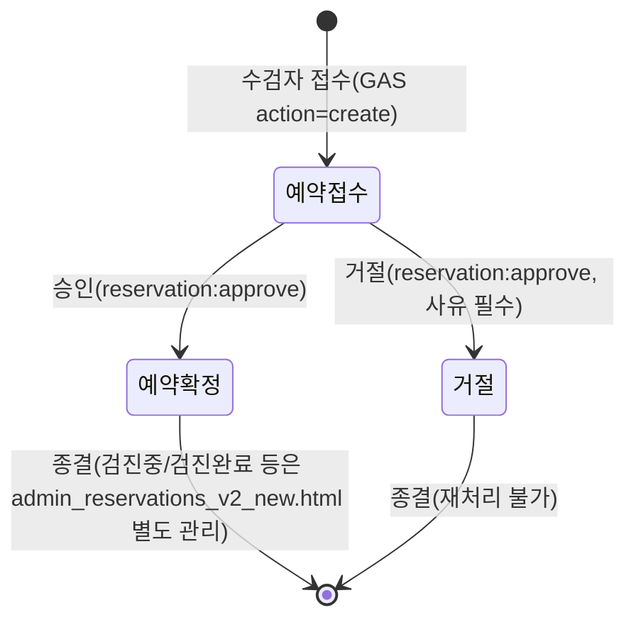

# ADR-014: 예약 승인 State Machine을 공식 상태 모델로 확정한다

> **상태**: 제안(Sprint 4 Commit 3 Design Phase — PM 승인 후 `DECISIONS.md`에 정식 등재. 이 문서 자체가 신규 파일로서 초안 역할을 한다. `DECISIONS.md` 원본은 이번 단계에서 수정하지 않았다.)
> **작성일**: 2026-07-28
> **범위**: Google Sheets(SSOT, ADR-013) 예약의 승인/거절 상태 전이만 다룬다. Slot 상태(`Sprint4_Commit3_Slot_Capacity_Design_v1.0.md` §5)는 별도 개념이며 이 ADR의 범위 밖이다.

---

## 배경

Sprint 4 Commit 2(Reservation Approval Foundation)에서 `src/api/reservation_approval_states.py`에 Sheets 예약 전용 승인 State Machine을 이미 구현·배포했다(코드는 이 ADR 이전에 작성됨). 이 ADR은 그 구현을 소급하여 공식 아키텍처 결정으로 문서화한다 — 코드가 결정을 앞선 것은 Commit 2가 PM 조건부 승인(Sprint4_Commit2_Implementation_Plan_v1.0.md §12-1)을 통해 상태 전이 범위를 이미 확정했기 때문이며, 이번 Commit 3에서 Slot 설계를 진행하기 전에 그 결정을 ADR로 정식화해 두는 것이 필요하다고 판단했다.

## 결정

### 예약 상태(Sheets 도메인)

이번 ADR이 다루는 상태는 다음 3가지다. Sheets `예약상태` 컬럼이 가질 수 있는 다른 값(검진중/검진완료/일정변경/예약취소 등, `Reservation_Data_Mapping_and_Migration_Plan_v1.0.md` §5)은 기존 `admin_reservations_v2_new.html`이 계속 담당하며 이 ADR의 관리 대상이 아니다.

| 상태 | 의미 |
|---|---|
| `예약접수` | 수검자 접수 직후 기본값. 승인 대기 상태를 겸한다(별도 "승인대기" 상태를 신설하지 않음 — ADR-013 이후 첫 결정, Commit 2 §12-1에서 확정). |
| `예약확정` | 직원 승인 완료. |
| `거절` | 직원 거절 완료(Sheets에 원래 없던 값, Commit 2에서 신설 — `LEGACY_STATUS_MAP`에 `REJECTED`로 매핑). |

### 허용 전이

`예약접수 → 예약확정`, `예약접수 → 거절` **두 가지만 허용**한다. 그 외 모든 전이(이미 처리된 건 재처리, 종결 상태에서의 역행 등)는 차단한다.

### 409 정책

허용되지 않는 전이 시도는 HTTP 409로 응답한다. 사유를 세분화하지 않고(예: "이미 승인됨" vs "이미 거절됨" vs "존재하지 않는 상태"를 구분하지 않음) **"현재 상태에서 처리할 수 없습니다 — 다른 사용자가 이미 처리했거나 승인/거절 대상 상태가 아닙니다"로 통일**한다. 이는 동시성 상황(두 관리자가 거의 동시에 같은 건을 처리)과 단순 순서 오류(이미 종결된 건을 다시 처리하려는 시도)를 클라이언트가 구분할 필요가 없다는 판단에 근거한다 — 어느 경우든 사용자가 취할 조치는 동일하다(목록을 새로고침하고 현재 상태를 확인).

### 422 정책

거절 시 사유(`reason`)는 **필수**이며 다음 규칙을 모두 통과해야 한다(위반 시 422, Pydantic validator가 FastAPI 표준 422로 자동 변환).

- 앞뒤 공백 제거 후 비어 있지 않을 것
- 최소 2자, 최대 200자
- 전화번호·주민등록번호로 의심되는 연속 숫자(구분자 제거 후 6자리 이상) 미포함 — 완전한 PII 탐지가 아닌 휴리스틱임을 명시

승인(`예약확정`)에는 별도 입력이 없으므로 422 대상이 아니다.

### Audit 원칙

- Sheets 상태 변경(GAS `updateStatus`)이 **성공한 후에만** Audit을 기록한다 — 실패 시 Audit을 남기지 않는다.
- 승인: `RESERVATION_APPROVED` — 예약번호(entityId)/이전 상태(before)/변경 상태(after)/처리 사용자(actorUserId)/처리 시각(timestamp, 자동).
- 거절: `RESERVATION_REJECTED` — 위 5가지 + 거절 사유(note).
- Audit 기록 자체가 실패하는 경우(파일 I/O 오류 등)에 대한 보상 트랜잭션(상태 롤백)은 두지 않는다 — 기존 로컬 JSON 승인 흐름(`reservation_engine.py::approve_reservation()`)도 동일하게 "쓰기 성공 → 감사기록" 순서이며 감사기록 실패 시 별도 롤백이 없다는 것을 Commit 2에서 확인했고(Sprint4_Commit2_Implementation_Plan_v1.0.md §12-6), 이 ADR은 그 기존 정책을 Sheets 도메인에도 동일하게 적용하는 것으로 공식화한다.

## 이 ADR이 "Reservation Approval Foundation"의 공식 상태 모델임을 선언

`src/api/reservation_approval_states.py::SHEETS_APPROVAL_TRANSITIONS`가 이 ADR의 유일한 구현이며, 향후 이 상태 모델을 변경하려면(예: Slot 정원 정책과 연동해 승인 전 단계를 추가하는 등, `Sprint4_Commit3_Slot_Capacity_Design_v1.0.md` §6 참조) 새 ADR로 이 ADR을 Supersede해야 한다 — 코드만 조용히 바꾸지 않는다(ADR-008이 실제 운영과 괴리되어 ADR-012로 대체해야 했던 전철을 반복하지 않기 위함).

## 대안 검토

- **로컬 JSON의 9-상태 머신(`state_machine.py`)을 Sheets에도 그대로 적용**: 기각. `PENDING_APPROVAL`/`WAITING`/`NO_SHOW`/`REQUESTED` 등은 Sheets 워크플로에 대응 개념이 없어(`Reservation_Data_Mapping_and_Migration_Plan_v1.0.md` §5) 그대로 가져오면 도달 불가능한 상태가 다수 생긴다.
- **거절 시 사유를 선택 입력으로 둠**: 기각. PM 결정 2(Sprint4_Commit2_Implementation_Plan_v1.0.md §12-2)가 필수 입력 및 검증을 명시적으로 요구했다.
- **409 사유를 세분화해 반환**: 기각(단순화 선택). 클라이언트 처리가 동일해 구분 실익이 적고, 세분화하면 오히려 "왜 실패했는지"를 공격자가 유추하는 데 쓰일 수 있는 정보 노출 여지가 생긴다(사소하지만 보수적으로 판단).

## 상태

제안(Draft). PM 승인 시 `DECISIONS.md`에 정식 ADR로 등재하는 것은 별도 승인된 작업(문서 수정)으로 진행하며, 이번 Design Phase에서는 수행하지 않았다.
