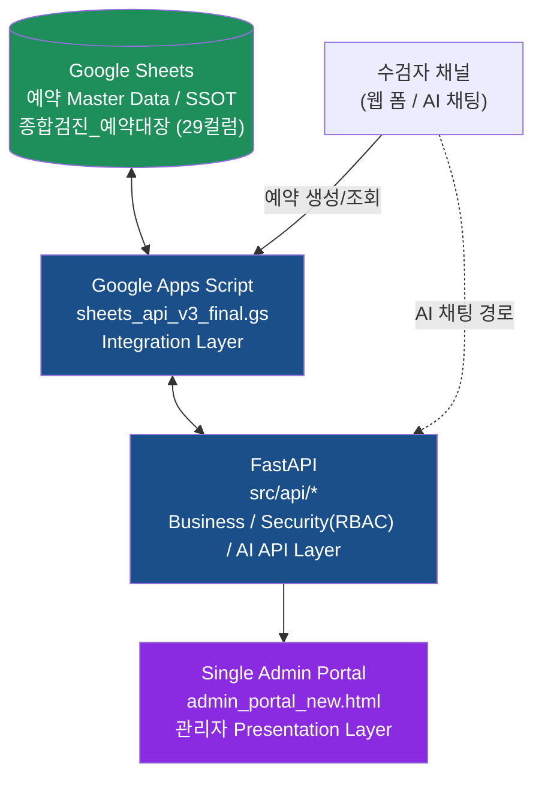
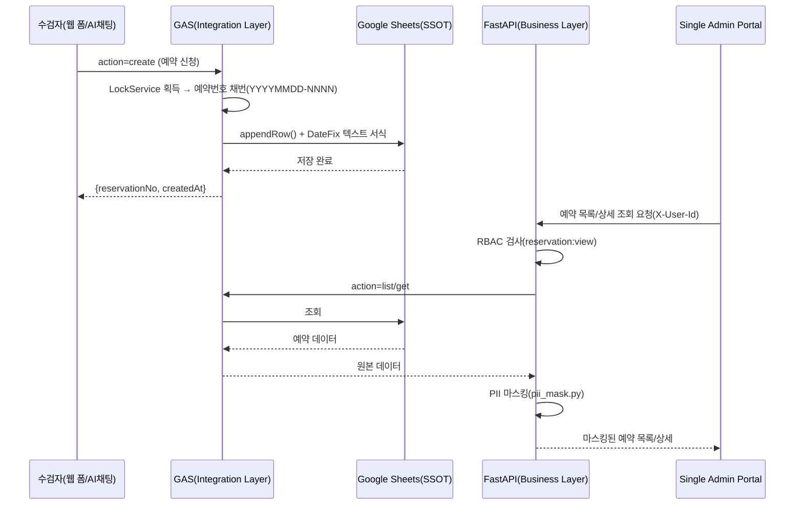
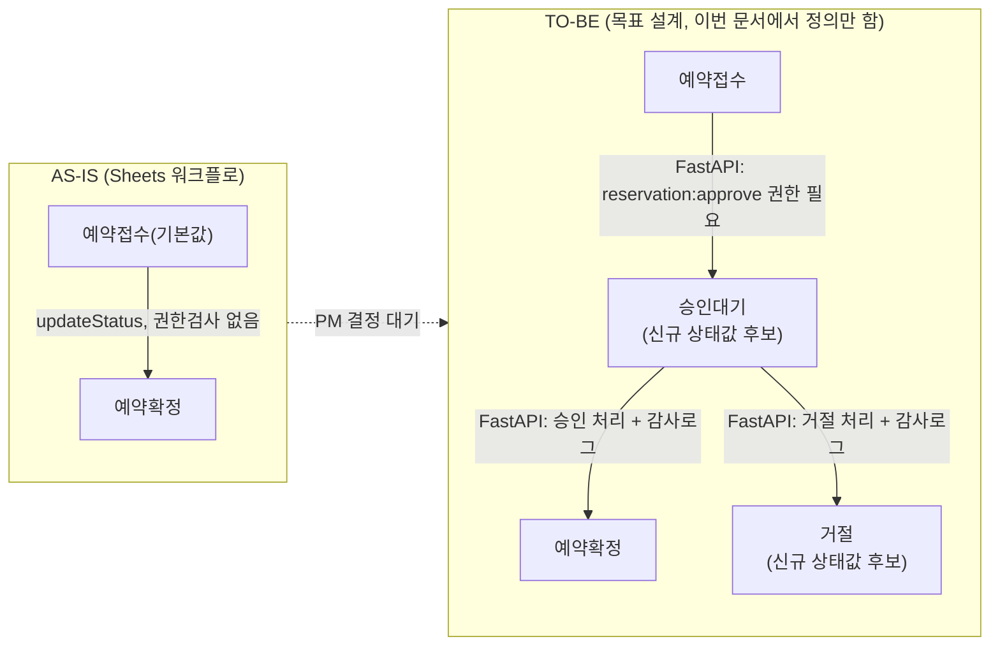
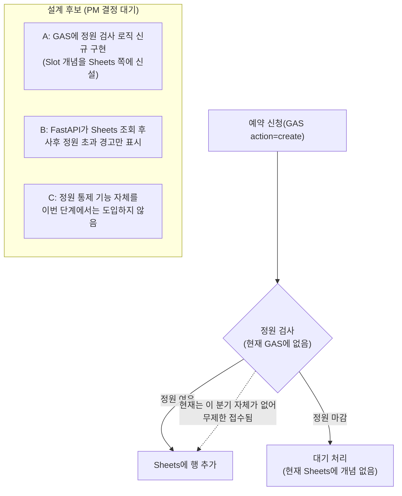
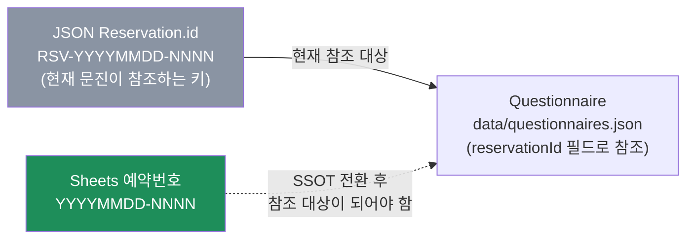
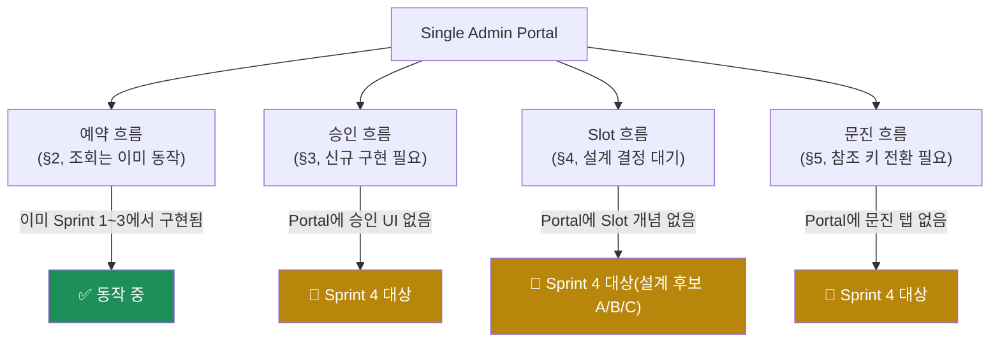

# Reservation Core Architecture v1.0

> **성격**: Sprint 4 Baseline 설계 문서. PM이 확정한 계층 구조(Sheets→GAS→FastAPI→Portal)를 기준으로 예약/승인/Slot/문진 4대 흐름의 **목표(TO-BE) 설계**를 정리한다. 이번 문서로 코드를 변경하지 않았다 — GAS/FastAPI/Portal 모두 현재 코드 그대로다.
> **작성일**: 2026-07-28
> **선행 근거**: `ADR_Reservation_Master_Data_Google_Sheets_Draft.md`(SSOT=Sheets 확정), `Reservation_Data_Mapping_and_Migration_Plan_v1.0.md`(필드/상태 매핑), `Sprint4_Architecture_Gate_Report_v1.0.md`(갭 식별)

---

## 1. 계층 구조 (PM 확정)

각 계층의 책임은 다음과 같이 확정한다.

| 계층 | 책임 | 현재 코드 근거 |
|---|---|---|
| Google Sheets | 예약 데이터의 유일한 영구 저장소(SSOT) | `sheets_api_v3_final.gs`의 `SPREADSHEET_ID`/`SHEET_NAME` |
| Google Apps Script | Sheets 접근을 중개하는 Integration Layer(8개 action: ping/list/get/summary/create/updateStatus/updateOps/update) | `sheets_api_v3_final.gs` doGet/doPost |
| FastAPI | 인증·권한(RBAC)·승인 워크플로·감사로그·AI 오케스트레이션을 담당하는 Business/Security/AI Layer — Sheets를 참조·가공하되 자체 원장을 갖지 않는 방향으로 재정의 | `src/api/api_server.py`, `routes_admin_portal.py`, `routes_agents.py`, `src/agents/*` |
| Single Admin Portal | 관리자용 Presentation Layer, FastAPI를 통해서만 데이터에 접근 | `admin_portal_new.html` |

**AI 채팅 경로는 현재 로컬 JSON을 거치므로(점선 화살표) 이 계층도를 완전히 만족하지 못한다** — 이는 Sprint 4의 해결 대상이며, `Sprint4_Implementation_Plan_v1.0.md`의 Commit 순서에서 다룬다. 이 문서는 목표 구조를 정의할 뿐, 이번 Commit에서 그 갭을 메우지 않는다.

## 2. 예약 흐름 (Reservation Flow)

예약 생성은 모든 채널(웹 폼, 향후 AI 채팅)에서 GAS `action=create`로 수렴해야 하며, 조회는 Portal→FastAPI→GAS→Sheets 순으로만 이루어진다(Portal이 GAS를 직접 호출하지 않는다 — 계층 스킵 금지).

## 3. 승인 흐름 (Approval Flow) — 현재 갭 포함

`Reservation_Data_Mapping_and_Migration_Plan_v1.0.md` §5/§6에서 이미 확인했듯, 현재 Sheets는 `예약접수→예약확정` 직접 전이만 가능하고 권한 검사·거절·감사로그가 없다. TO-BE는 FastAPI가 이 갭을 메우는 안(승인 대기 상태값 신설, `reservation:approve` 권한 검사, 거절 시 `REJECTED` 상당 상태 기록, 감사로그는 기존 `audit_logs.json` 패턴 재사용)을 **설계로만** 제시한다. 상태값 신설(`승인대기` 등) 여부는 `Sprint4_Architecture_Gate_Report_v1.0.md` §9-1에서 이미 PM 결정 필요 사항으로 등록되어 있으며, 이 문서는 그 결정이 내려졌을 때 따를 흐름을 미리 그려둔 것이다.

## 4. Slot 흐름 (Capacity Flow) — 현재 갭 포함

`Sprint4_Architecture_Gate_Report_v1.0.md` §7에서 이미 식별한 대로, Slot(정원) 개념은 현재 로컬 JSON에만 존재하고 Sheets/GAS에는 전혀 없다. 이 문서는 3가지 설계 후보(A/B/C)를 나열만 하며, 어떤 안을 택할지는 PM 승인 사항으로 남긴다(§9 승인 필요 사항 참조).

## 5. 문진 흐름 (Questionnaire Flow) — 참조 키 전환 필요

문진(`Questionnaire`) 데이터는 Sheets에 대응 컬럼이 전혀 없는 순수 JSON 개념이며, 지금은 JSON `Reservation.id`(`RSV-` 접두어 포함)를 참조 키로 쓴다. Sheets가 SSOT가 되면 신규 예약은 Sheets `예약번호`(접두어 없음)로만 식별되므로, 문진이 참조할 키를 Sheets 포맷으로 전환해야 한다는 것이 `Reservation_Data_Mapping_and_Migration_Plan_v1.0.md` §8의 결론이다. 이 문서는 그 전환이 필요하다는 사실과 방향(위 다이어그램의 점선)만 명시하며, `questionnaire_service.py`의 실제 참조 로직 수정은 Sprint 4 Commit 4(문진, `Sprint4_Implementation_Plan_v1.0.md` 참조)에서 다룬다.

## 6. 4대 흐름 요약 (Portal 관점)

## 7. 이 문서가 정의하지 않는 것

- 승인 대기 상태값의 정확한 문자열, Slot 설계 후보 A/B/C 중 최종 선택, 문진 참조 키 전환의 구체적 코드 변경 방법 — 모두 PM 승인 이후 별도 Implementation Plan(Sprint 4 Commit 2~4)에서 확정한다.
- GAS/FastAPI/Portal의 실제 코드 변경 — 이번 문서는 목표 아키텍처 정의이며, Commit 0(문서 Baseline)의 "코드 수정 0줄" 원칙에 따라 어떤 실행 코드도 건드리지 않았다.
