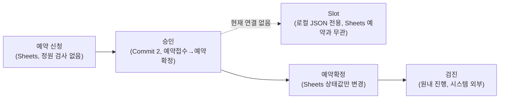
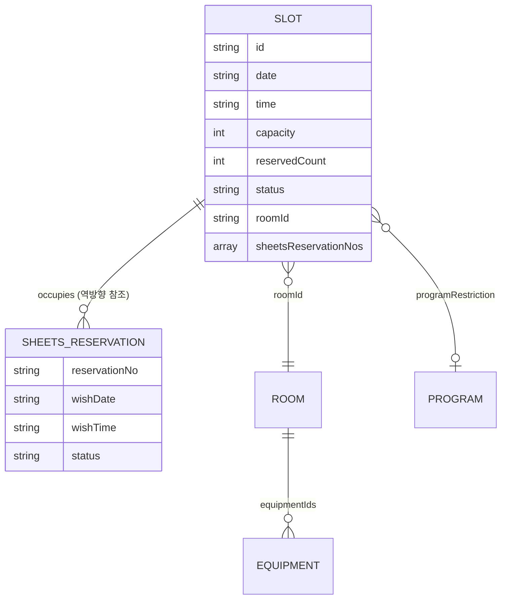
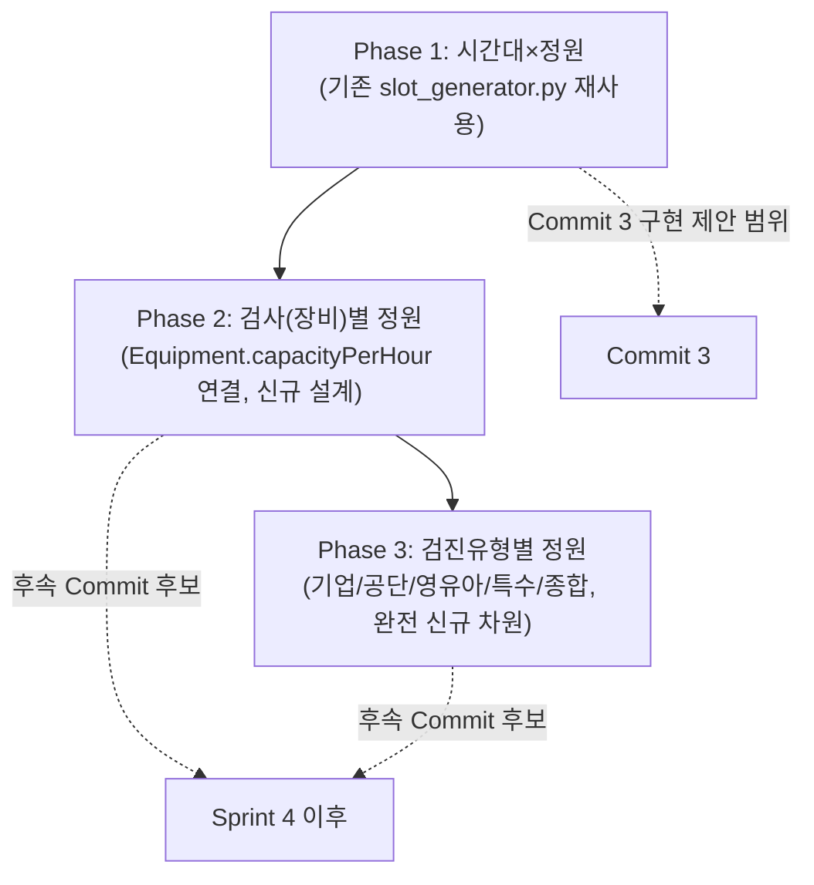
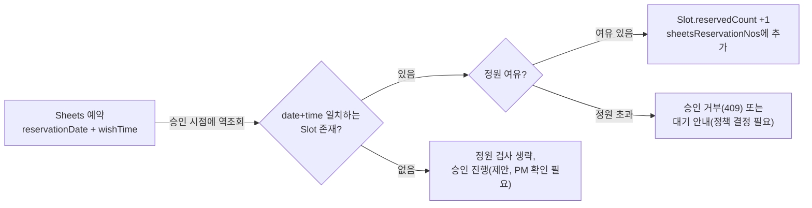
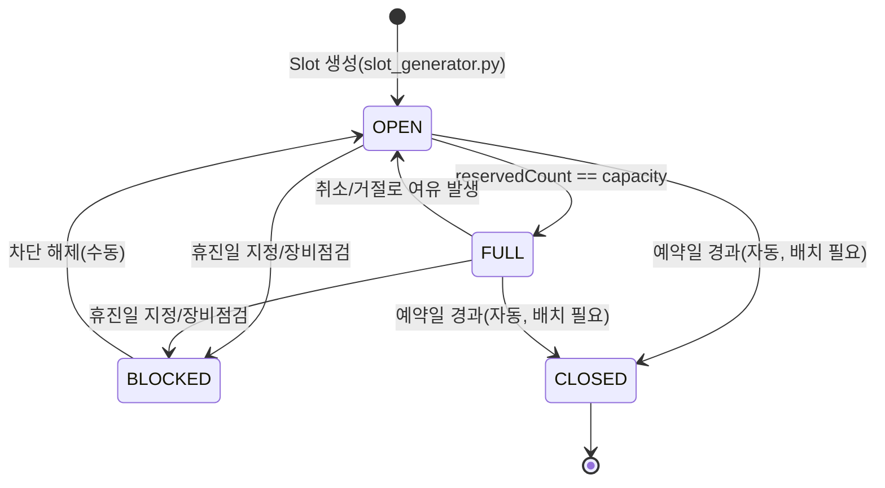
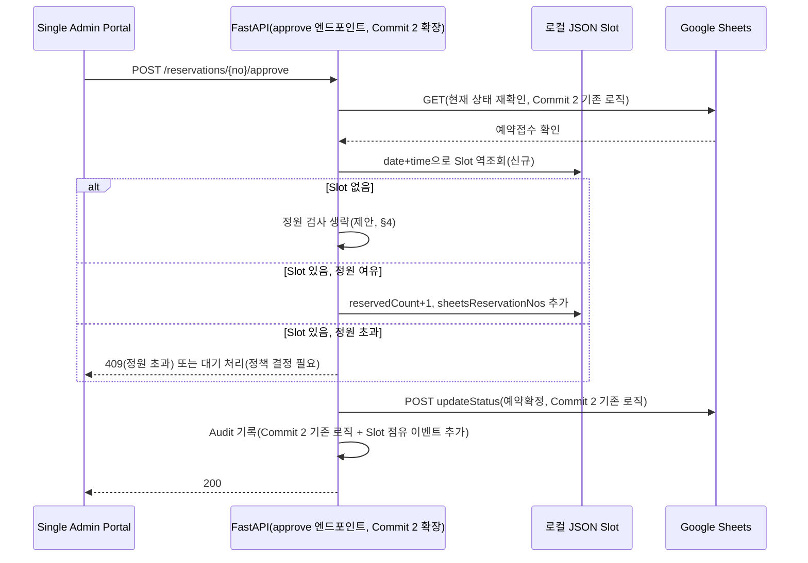
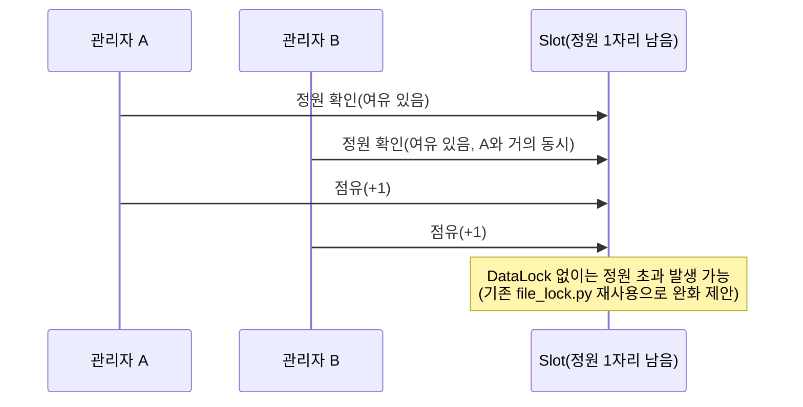

# Sprint 4 Commit 3 — Slot Capacity Foundation: Design Phase v1.0

> **성격**: Architecture Design 문서. **코드를 작성하지 않았다** — FastAPI/GAS/Portal/Google Sheets 전부 무수정, Commit 없음, Push/Deploy/운영데이터 변경 없음.
> **작성일**: 2026-07-28
> **목적**: 병원 운영에 적용 가능한 Slot 운영 기준을 확정한다. 이 문서가 PM 승인을 받으면 그 다음 별도 Implementation Plan으로 Commit 3의 실제 구현을 진행한다(Commit 2와 동일한 2단계 절차).

---

## 1. 조사 결과

### 1-1. Repository 내 Slot/Schedule/Calendar/Capacity/Reservation 관련 코드 전수 조사

| 파일 | 역할 |
|---|---|
| `src/reservation/slot_generator.py` | 영업일×시간대×정원으로 Slot 생성. **주말 제외, `schedules.json`의 HOLIDAY/BLOCKED 날짜 제외**. 기본 10개 시간대(`08:00~14:00`, **점심시간 12:00~13:00은 이미 목록에서 빠져 있음** — 별도 로직 없이 시간 목록 자체가 점심시간을 건너뜀), 기본 정원 6, 기본 `roomId=ROOM-0001`. `programRestriction`이 없으면(기본값) 모든 프로그램이 같은 Slot 풀을 공유한다. |
| `src/reservation/reservation_engine.py::validate_slot()` | 예약 신청 시 Slot 존재/날짜 일치/프로그램 제한/휴진일/Slot 상태(BLOCKED/HOLD)/동일 환자 중복예약을 검사해 `AVAILABLE\|FULL\|WAITING\|DUPLICATED\|HOLD\|BLOCKED\|INVALID` 판정을 반환. **정원 초과 시 자동으로 WAITING(대기예약) 전환**(호출자가 `allow_waiting=True`일 때만). |
| `src/reservation/reservation_engine.py::approve_reservation()` | 승인 시 `Slot.reservedCount += 1`, 정원 도달 시 `FULL`로 전환(`SLOT_FULL` 감사 이벤트). |
| `src/reservation/reservation_engine.py::cancel_reservation()`/`reject_reservation()` | 취소/거절 시 Slot 복구(`_release_slot`, 정원 여유 발생 시 `AVAILABLE`로 환원). |
| `src/reservation/alternative_slot_recommender.py` | 요청 Slot 불가 시 대체 Slot 최대 5개 추천 — AVAILABLE+정원여유+프로그램제한 충족, 같은 검사실 우선, 날짜/시간 근접순. |
| `src/reservation/reservation_engine.py::release_hold()` | HOLD 상태 Slot을 수동 해제(`slot:manage` 권한). |
| `src/api/api_server.py` | `GET /api/slots`(조회), `GET /api/slots/recommend`(대체추천), `POST /api/slots/generate`(생성, `slot:manage`), `POST /api/slots/{id}/release-hold`(해제) — 4개 엔드포인트, **전부 로컬 JSON `Slot` Entity 대상**. |
| `admin/admin_api.js` | Mock 모드에서 `occupySlot()`/`releaseSlot()`/`releaseHold()`로 위 엔진 로직을 JS로 미러링(Sprint C). `slotRows()`로 Slot 관리 화면(View) 데이터 구성. |
| `data/schedules.json` | `type=HOLIDAY, status=BLOCKED` 레코드로 공휴일/병원 휴진일 표현. Slot 생성 시 이 날짜를 건너뛴다. |
| `data/rooms.json` | 8개 검사실, 자체 `capacity` 필드(Slot의 capacity와는 **별개 개념** — 방 동시수용 인원), `equipmentIds` 배열로 장비 연결. |
| `data/equipment.json` | 4개 장비(MRI 3.0T, 위내시경 세척기, CT 촬영기, 초음파 시스템) — 각각 `capacityPerHour`(시간당 처리량), `roomId`. **이 시간당 처리량은 현재 어떤 코드에서도 Slot 정원 계산에 사용되지 않는다**(데이터는 있으나 로직 미연결 — §14 기술부채). |

### 1-2. Google Sheets 예약 구조 — Slot 관련 컬럼 조사

`Reservation_Data_Mapping_and_Migration_Plan_v1.0.md` §1(29개 컬럼 전수)을 재확인한 결과 **Slot·정원·검사실 동시수용인원에 해당하는 컬럼이 전혀 없다.** `검진실`(컬럼23)은 검사실 이름을 적는 자유 텍스트일 뿐 `Room`/`Equipment` Entity와 연결되지 않으며, `검진예정시간`(컬럼19)도 시각 문자열일 뿐 Slot 식별자가 아니다. `sheets_api_v3_final.gs::_actionCreate()`는 정원 검사 로직이 전혀 없어 같은 날짜/시간에 몇 건이 접수되든 무제한으로 저장된다(코드 확인, 재확인 완료).

### 1-3. 예약 흐름(예약→승인→Slot→예약확정→검진) 현황

PM이 제시한 "예약→승인→Slot→예약확정→검진" 흐름에서 **"Slot" 단계가 현재는 완전히 비어 있다** — Commit 2(승인)는 Sheets 상태만 바꿀 뿐 Slot을 전혀 참조하지 않는다. Slot 개념 자체는 로컬 JSON 쪽에 이미 잘 구현되어 있지만(§1-1), Sheets 예약과 연결하는 다리가 없다는 것이 이번 Commit 3 설계의 핵심 과제다.

### 1-4. 현재 Legacy Slot 기능 조사

`admin/index.html`의 "Slot 관리" View(`data-view="slots"`)가 유일한 Slot 관리 화면이다. `admin_api.js::slotRows()`가 Slot 목록(날짜/시간/정원/예약수/대기수/상태)을 구성하고, HOLD 해제 버튼이 `releaseHold()`를 호출한다. **Slot 생성 UI는 없다** — `POST /api/slots/generate`를 호출하는 화면 자체가 확인되지 않음(API는 있으나 프론트가 없음, 운영자가 직접 API를 호출하거나 별도 스크립트로 생성하는 것으로 추정). 이 화면은 로컬 JSON `Slot` Entity만 다루며 Sheets와 무관하다.

### 1-5. Single Admin Portal Slot 구조 조사

`app/pages/admin_portal_new.html` 전체를 "slot" 키워드로 검색한 결과 **일치하는 코드가 0건**이다 — Single Admin Portal(Sprint 1~3)에는 Slot 관련 탭·API 호출·UI가 전혀 없다. 이번 Commit 3이 Portal에 Slot 개념을 도입하는 **최초 시도**가 된다.

---

## 2. Slot Entity 필드 정의

기존 로컬 JSON `Slot` Entity(`docs/CSHSP_Core_Data_Layer_Sprint_A.md` §5, `slot_generator.py` 생성 필드)를 그대로 기준선으로 삼는다 — **신규 Entity를 새로 설계하지 않고 기존 필드에 Sheets 연동에 필요한 필드만 추가**한다.

| 필드 | 타입 | 기존/신규 | 설명 |
|---|---|---|---|
| `id`(slotId) | `SLOT-YYYYMMDD-HHMM-A` | 기존 | 변경 없음 |
| `date` | `YYYY-MM-DD` | 기존 | 변경 없음 |
| `time` | `HH:mm` | 기존 | 변경 없음 |
| `capacity` | 정수 | 기존 | 변경 없음(기본 6) |
| `reservedCount` | 정수 | 기존 | 변경 없음 |
| `waitingCount` | 정수 | 기존 | 변경 없음 |
| `status` | Enum | 기존(값 재정의, §5) | 값 집합을 `OPEN/FULL/CLOSED/BLOCKED`로 재정의(§5에서 기존 값과의 매핑 제시) |
| `roomId` | FK(Room) | 기존 | 변경 없음 |
| `programRestriction` | FK(Program) 또는 null | 기존 | 변경 없음 |
| `note` | 문자열 | 기존 | 변경 없음 |
| **`sheetsReservationNos`** | 문자열 배열 | **신규(제안)** | 이 Slot을 점유 중인 **Sheets 예약번호**(`YYYYMMDD-NNNN`, 접두어 없음) 목록. Sheets 예약에는 `slotId` 필드가 없으므로(§1-2) FK 방향을 거꾸로(Slot→Sheets예약번호 배열) 유지하는 방식을 제안(§4에서 근거 설명) |
| `checkupType` | 문자열 또는 null | **신규(제안, 후순위)** | 기업검진/공단검진/영유아검진/특수건강진단 등 검진유형 구분(§4 Capacity 정책 Phase 3). MVP(Commit 3)에서는 null 허용, 실제 값 채우기는 후속 Commit 과제로 제안 |

---

## 3. Capacity 정책

현재 데이터(§1-1)를 기준으로 **3단계 정책을 제안**하며, Commit 3은 Phase 1만 구현 범위로 제안한다(§ 최종 보고 10. PM 의사결정 필요 사항).

### Phase 1 — 시간대 정책(기존 `slot_generator.py` 그대로 재사용, 즉시 구현 가능)

- 오전/오후 시간대는 기존 `DEFAULT_TIMES`(08:00~11:00, 13:00~14:00) 그대로 사용 — **점심시간(12:00~13:00)은 이미 목록에 없어 자동 배제**(신규 로직 불필요).
- 정원은 Slot 단위 정수(`capacity`, 기본 6) — 기존 그대로.
- 주말·공휴일 제외 — 기존 그대로.

### Phase 2 — 검사(장비)별 정원(후속 제안, Commit 3 범위 밖)

MRI/CT/위내시경/초음파 4개 장비의 `capacityPerHour`(시간당 처리량, §1-1 데이터 확인)를 Slot 단위(30분)로 환산해(`capacityPerHour ÷ 2`, 반올림 정책 별도 필요) 장비 연결 검사실(`Room.equipmentIds`)의 Slot 정원 상한으로 반영하는 방안. **대장내시경 전용 장비는 현재 `equipment.json`에 별도 레코드가 없어(§1-1) 데이터 보완이 선행되어야 함.**

### Phase 3 — 검진유형별 정원(후속 제안, Commit 3 범위 밖)

기업검진/공단검진/영유아검진/특수건강진단/종합검진(CLAUDE.md "업무 분류 기준"과 동일 체계)은 **현재 `Program`/`Slot` 어느 Entity에도 대응 필드가 없는 완전히 새로운 분류 차원**이다(§2의 `checkupType` 신규 필드 제안이 이 Phase의 시작점). 검진유형별 정원(예: "이 시간대는 기업검진 단체예약 4명까지만") 정책은 이번 설계에서 필드만 예약해 두고 실제 정책 로직은 제안하지 않는다 — 실제 운영 규칙(우선순위, 단체예약 처리 방식 등)은 병원 운영팀의 별도 확인이 필요하다고 판단했기 때문이다.

---

## 4. Reservation ↔ Slot 관계

**핵심 설계 결정 제안**: Sheets 예약에는 `slotId` 필드가 없고(§1-2), 이번 Commit도 Google Sheets 구조 변경이 금지되어 있으므로(절대 금지 원칙), **Slot이 Sheets 예약을 참조하는 방향(역참조)으로 설계**한다 — Sheets 예약이 Slot을 참조(FK)하는 기존 로컬 JSON 방식(정방향)을 그대로 가져올 수 없기 때문이다.

- 승인 시점(Commit 2의 `POST /api/admin/reservations/{no}/approve`)에 예약의 `reservationDate`+`wishTime`(+`program`)으로 **Slot을 역으로 조회**한다(`date`+`time` 일치, 필요 시 `programRestriction` 일치).
- 매칭된 Slot의 `sheetsReservationNos` 배열에 예약번호를 추가하고 `reservedCount`를 증가시킨다.
- 매칭되는 Slot이 없으면(해당 시간대에 Slot이 아예 생성되지 않은 경우) **정원 검사를 건너뛰고 승인은 허용**하는 것을 제안한다 — Slot 미생성을 이유로 정상 승인을 막으면 기존 운영(Slot 없이도 승인 가능했던 지금까지의 흐름)을 저해하기 때문이다. 이 정책은 PM 확인이 필요하다(§ 최종 보고 10).

---

## 5. Slot 상태(State) 및 State Machine

PM 예시(OPEN/FULL/CLOSED/BLOCKED)를 채택하되, 기존 로컬 JSON Slot 상태(AVAILABLE/FULL/WAITING/HOLD/BLOCKED, `docs/CSHSP_Core_Data_Layer_Sprint_A.md` §7)와의 관계를 명확히 한다 — **이번 Commit이 다루는 것은 로컬 JSON Slot이 아니라 "Sheets 예약과 연결되는 Slot 조회/정원 확인" 관점**이므로, Commit 2가 Sheets 도메인 전용 State Machine을 별도로 만든 것과 같은 패턴으로 Slot도 **Sheets 연동 관점의 축약된 상태 4종**을 정의한다.

| 신규(Sheets 연동 관점) | 기존 로컬 JSON 대응 | 의미 |
|---|---|---|
| `OPEN` | `AVAILABLE` | 정원 여유, 승인 가능 |
| `FULL` | `FULL` | 정원 도달, 승인 시 정원 정책에 따라 차단/대기 |
| `CLOSED` | (신규 개념) | 날짜가 지났거나 운영 종료된 Slot — 과거 Slot을 승인 대상에서 제외하기 위한 상태(기존 로컬 JSON에는 이 구분이 없었음, Sheets 연동에서 새로 필요해진 이유는 승인이 예약일보다 늦게 이뤄질 수 있기 때문) |
| `BLOCKED` | `BLOCKED` | 휴진일/장비점검 등으로 차단 |

`WAITING`/`HOLD`(로컬 JSON 전용 상태)는 이번 Sheets 연동 설계에 포함하지 않는다 — 대기예약·보류 개념을 Sheets 승인 흐름에 도입할지는 Phase 2 이후 후속 논의로 제안한다(§13 위험요소에서 재언급).

---

## 6. 예약 승인 시 Slot 확인 Workflow

이 Workflow는 **Commit 2가 이미 구현한 `_process_reservation_approval()`을 확장**하는 형태로 설계한다(신규 엔드포인트를 또 만들지 않음 — 기존 승인 엔드포인트 내부에 Slot 확인 단계를 추가) — Commit 2 완료 시점의 코드 재사용 원칙을 그대로 계승한다.

---

## 7. Google Sheets 매핑 — 현재 구조 유지 가능 여부

**가능하다.** §4에서 설계한 대로 Slot이 Sheets 예약을 역참조(date+time 매칭)하는 방식을 쓰면 **Sheets 29개 컬럼에 어떤 신규 컬럼도 추가할 필요가 없다.** 이는 이번 Commit 3의 "Google Sheets 수정 금지" 원칙과 정확히 맞아떨어지는 설계이며, 우연이 아니라 §4의 설계를 그 원칙에 맞춰 의도적으로 선택한 것이다.

**제약**: 역참조 매칭이 `reservationDate`+`wishTime` 문자열 일치에 의존하므로, Sheets 예약의 `희망시간` 값이 Slot 생성 시 쓰인 시간 포맷(`HH:mm`, 정시/30분 단위)과 정확히 일치해야 매칭된다. 수검자가 웹 폼에서 임의 시각(예: `09:15`)을 입력할 수 있는 구조라면 매칭 실패가 발생할 수 있다 — `reservation_v3_new.html`의 희망시간 입력 UI가 정해진 Slot 시간 목록에서만 선택하게 되어 있는지는 이번 조사 범위 밖이며, 별도 확인이 필요하다(§13 위험요소).

---

## 8. Google Apps Script 변경 필요 여부

**필요 없음.** Slot 확인·점유는 FastAPI(Business Layer)와 로컬 JSON Slot 저장소 사이에서만 일어나며, GAS는 기존 `updateStatus` action(Commit 2가 이미 재사용 중)을 그대로 다시 호출할 뿐이다. Slot 관련 정보를 GAS에 보낼 필요가 전혀 없다.

---

## 9. FastAPI 변경 범위(설계, 이번 Commit 3 Design Phase에서는 미구현)

| 변경 지점 | 내용 |
|---|---|
| `_process_reservation_approval()`(Commit 2, `routes_admin_portal.py`) | Slot 역조회·정원 검사·점유 갱신 단계를 write(GAS updateStatus) **직전**에 추가(§6 Workflow) |
| 신규 함수(제안) | `find_slot_by_datetime(date, time, data_dir)` — 기존 `Slot` Entity를 date+time으로 조회하는 헬퍼. 기존 `loader.load_entity("Slot", data_dir)` 재사용, 신규 저장 로직 없음 |
| 권한 | 신규 권한 문자열을 만들지 않고 **기존 `reservation:approve`를 그대로 사용**(Slot 점유는 승인의 부수 효과이지 별도 권한이 필요한 독립 행위가 아니라고 판단) |
| `GET /api/admin/reservations`(Commit 2 확장 후보) | 목록 조회 응답에 해당 Slot의 잔여 정원을 함께 내려줄지는 Portal UI 설계(§10)에 따라 결정 |

---

## 10. Portal UI 영향

Single Admin Portal에는 현재 Slot 개념이 전혀 없으므로(§1-5) 최소 변경을 제안한다 — **신규 Slot 관리 탭을 만들지 않고**, 예약조회 탭의 승인 결과 토스트에 정원 관련 안내만 추가하는 것으로 범위를 좁힌다.

- 승인 성공 토스트: 기존 "승인되었습니다" 메시지 유지.
- 승인 거부(정원 초과, 신규 409 사유) 토스트: 기존 409 처리 로직(Commit 2, `handleApprovalConflict`)에 정원 초과 사유가 섞이지 않도록 **별도 메시지 분기가 필요할 수 있음**(현재 409는 "다른 사용자가 이미 처리했거나..."로 고정 문구인데, 정원 초과도 같은 409로 묶으면 운영자가 원인을 오인할 수 있음 — §13 위험요소로 기록).
- Slot 관리 전용 화면(생성/차단/조회)은 이번 Commit 범위에 포함하지 않는 것을 제안한다 — 기존 `admin/index.html`의 Slot 관리 View가 이미 이 역할을 하고 있으므로 중복 구현을 피한다(Sprint 3.5/Gate에서 확립한 "기존 기능 재사용" 원칙).

---

## 11. 동시성(Concurrency) 분석

Commit 2에서 이미 식별한 한계(GAS `updateStatus`가 compare-and-swap 미지원)에 더해, Slot 정원 검사에는 **추가적인 경쟁 조건**이 있다.

- 두 관리자가 정원이 1자리 남은 같은 Slot에 대해 서로 다른 예약을 거의 동시에 승인하면, 둘 다 "정원 여유 있음"으로 읽은 뒤 둘 다 점유를 시도해 **정원을 초과 점유**할 수 있다(기존 로컬 JSON 승인 흐름도 `DataLock`으로 파일 잠금을 걸어 이 문제를 방지하고 있음 — `reservation_engine.py`가 아니라 `file_lock.py::DataLock`이 실제 방지 메커니즘).
- **완화 방안(제안)**: Slot 조회→점유 갱신 구간을 기존 `file_lock.py::DataLock`으로 감싼다(Sprint 3 CRM 상태변경이 이미 이 패턴을 쓰고 있음, 신규 동시성 메커니즘 불필요, 기존 것 재사용). 이렇게 하면 Slot 점유 자체는 원자적으로 처리되나, **Sheets 쪽 상태 변경(GAS updateStatus)과 Slot 점유(로컬 JSON) 사이의 원자성은 여전히 보장되지 않는다** — 두 저장소에 걸친 트랜잭션이므로(§ Reservation_Data_Mapping 문서에서 이미 여러 차례 확인된 이중 백엔드의 근본적 한계). Slot 점유는 성공했는데 Sheets 쓰기가 실패하는 경우(또는 그 반대) 불일치가 생길 수 있으며, 어느 쪽을 먼저 수행할지(Slot 우선 vs Sheets 우선)에 따라 실패 시 영향이 다르다 — 이 순서 결정은 PM 확인이 필요하다(§ 최종 보고 10).

---

## 12. 병원 운영 시나리오

| 시나리오 | 현재 설계로 처리 가능 여부 |
|---|---|
| **정원 초과** | Phase 1로 처리 가능(§4/§6) — 승인 시점에 409 또는 대기 정책(결정 필요) |
| **예약 변경**(날짜/시간 변경) | 부분 가능 — Sheets `update`/`updateOps` action으로 날짜·시간 자체는 이미 바꿀 수 있으나(기존 기능, Commit 3과 무관), **변경 시 기존 Slot을 해제하고 새 Slot을 점유하는 로직은 이번 설계에 없음**(승인 단계에서만 Slot을 다루므로, 승인 이후 변경 흐름은 후속 설계 필요) — §13 위험요소 |
| **예약 취소** | 부분 가능 — 로컬 JSON에는 `cancel_reservation()`이 Slot을 자동 복구하지만, **Sheets 예약 취소(`예약취소` 상태로 변경)가 발생했을 때 이미 점유된 Slot을 복구하는 로직은 이번 설계 범위 밖**(Commit 3은 승인 Workflow만 다룸, 취소 Workflow의 Slot 연동은 후속 Commit 후보로 제안) |
| **기업검진**(단체예약) | Phase 3(검진유형별 정원) 없이는 개별 Slot 정원(기본 6)을 그대로 적용받아, 단체예약 특성(같은 날 다수 인원)을 반영하지 못함 — Phase 3 후속 설계 필요 |
| **출장검진** | 이번 조사에서 출장검진이 Slot/Room/Equipment 어디에도 별도로 모델링되어 있지 않음이 확인됨(원내 검사실 기준 모델이므로 출장지에는 애초에 Room 개념이 안 맞음) — Slot Capacity Foundation의 적용 대상 밖으로 명시적으로 제외하는 것을 제안 |
| **영유아검진** | Phase 3(검진유형별 정원) 없이는 특별 취급 불가 — 일반 Slot과 동일하게 처리됨 |
| **종합검진** | 현재 Program 6종(BASIC/SMART/VIP/PREMIUM/YOUNG/온김에검진)이 모두 "종합검진" 범주에 속하며, `programRestriction`으로 이미 프로그램별 Slot 분리가 가능(기존 기능) — Phase 1만으로도 처리 가능 |

---

## 13. 위험요소

| # | 위험 | 등급 |
|---|---|---|
| 1 | Slot 미생성 시 정원 검사를 생략하는 제안(§4)이 채택되면, 관리자가 Slot을 미리 만들어두지 않은 시간대는 사실상 무제한 승인이 가능해 정원 정책이 유명무실해질 수 있음 | 높음 |
| 2 | 희망시간 자유 입력과 Slot 시간 목록 불일치 시 매칭 실패(§7) — 실제 UI 확인 필요 | 보통~높음 |
| 3 | 정원 초과(409)와 "이미 처리됨"(409, Commit 2 기존)이 Portal에서 같은 안내 문구로 뭉뚱그려지면 운영자가 원인을 오인(§10) | 보통 |
| 4 | Slot 점유와 Sheets 상태 변경 사이의 비원자성(§11) — 두 저장소 불일치 가능 | 보통~높음 |
| 5 | 예약 변경/취소 시 Slot 복구 로직이 이번 설계에 없어(§12), Commit 3을 승인 Workflow만으로 한정 구현하면 취소된 예약의 Slot이 계속 점유된 것으로 남아 정원이 실제보다 적게 표시되는 데이터 드리프트 발생 가능 | 높음 |
| 6 | Phase 2(장비 정원)용 `capacityPerHour` 데이터가 있으나 대장내시경 장비 레코드가 없음(§1-1) — Phase 2 착수 시 데이터 보완 선행 필요 | 낮음(Phase 2 착수 시점 이슈) |

---

## 14. 기술부채

1. **Equipment.capacityPerHour 미연결**(§1-1) — 데이터는 Sprint A부터 존재했으나 어떤 로직도 이를 정원 계산에 사용하지 않음. Phase 2에서 해소 제안.
2. **CLOSED 상태 자동 전이 배치 없음**(§5) — 예약일이 지난 Slot을 CLOSED로 옮기는 스케줄러/배치 작업이 없으면 상태가 수동 관리에 의존하게 됨.
3. **취소/변경 Workflow의 Slot 연동 부재**(§12, §13-5) — 이번 설계가 승인 시점만 다루기 때문에 생기는 구조적 공백. Commit 3 이후 별도 Commit으로 메워야 함.
4. **검진유형(기업/공단/영유아/특수) 분류 차원 부재**(§3 Phase 3) — Slot Capacity Foundation이 병원의 실제 업무 분류(CLAUDE.md 기준)와 아직 연결되지 않음.

---

## 부록: 조사에서 확인되지 않은 항목

- `reservation_v3_new.html`의 희망시간 입력이 자유 입력인지 정해진 목록 선택인지(§7 위험요소 근거) — 이번 세션에서 해당 파일의 시간 입력 UI 코드까지는 재확인하지 않음.
- 실제 운영 중 시간대별/검사별 정원 수치(현재 코드 기본값 6은 임의값으로 보이며 실제 병원 운영 기준치는 확인되지 않음) — 병원 운영팀 확인 필요.
