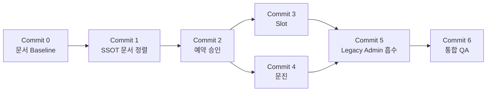

# Sprint 4 Implementation Plan v1.0 — Reservation Core Integration

> **성격**: Sprint 4 전체 Commit 로드맵. 이 문서 자체는 계획이며, Commit 0(문서 Baseline) 이후의 각 Commit은 Sprint 1~3에서 확립된 관행대로 **착수 직전에 별도 Implementation Plan을 작성해 PM 승인을 받은 뒤에만 코드를 작성한다.** 이번 문서 작성으로 Commit 1~6의 코드를 미리 구현하지 않았다.
> **작성일**: 2026-07-28
> **선행 근거**: `ADR_Reservation_Master_Data_Google_Sheets_Draft.md`, `Reservation_Data_Mapping_and_Migration_Plan_v1.0.md`, `SSOT_Document_Alignment_Plan_v1.0.md`, `Sprint4_Architecture_Gate_Report_v1.0.md`, `Reservation_Core_Architecture_v1.0.md`, `ADR-012_Git_Based_Version_Control.md`

---

## 원칙 (Sprint 1~3 관행 계승)

- 각 Commit 착수 전 별도 Implementation Plan 문서 작성 → PM 승인 → 코드 작성 순서를 지킨다.
- `git add .` / `git add -A` 금지, 커밋 전 `git diff --cached --name-only`로 stage 파일 확인(ADR-012).
- 기존 기능/엔드포인트/화면/Sheets/GAS를 삭제·수정하지 않는다 — 추가만 한다(Sprint 3까지의 원칙 유지).
- 코드가 포함되는 모든 Commit은 자동화 테스트 + 실브라우저 QA(임시 서버+샌드박스, 종료 후 삭제)를 거친다.
- Push/Deploy/운영데이터 변경은 PM이 별도로 명시 승인하기 전까지 하지 않는다.

## Commit 로드맵

### Commit 0 — 문서 Baseline (본 Commit)

- **내용**: `ADR-012_Git_Based_Version_Control.md`, `Reservation_Core_Architecture_v1.0.md`, `Sprint4_Implementation_Plan_v1.0.md`(본 문서), `SSOT_Update_Checklist.md` 4종 신규 문서만 생성.
- **코드 변경**: 0줄.
- **커밋 메시지**: `docs: establish Sprint 4 reservation core baseline`.
- **테스트**: 해당 없음(코드 변경 없음). 문서 존재 여부만 `git diff --cached --name-only`로 확인.

### Commit 1 — SSOT 문서 정렬

- **내용**: `SSOT_Update_Checklist.md`(Commit 0에서 생성된 체크리스트)를 따라 `ARCHITECTURE.md`/`ROADMAP.md`/`PROJECT_STATUS.md`를 실제로 정정하고, `DECISIONS.md`에 ADR-012를 정식 등재하며 ADR-008을 Superseded로 표기.
- **범위**: `SSOT_Document_Alignment_Plan_v1.0.md`(Sprint 4 Gate 단계 산출물)에서 이미 식별된 정정 대상만 반영 — 새로운 내용을 추가하지 않는다(문서 정정이지 문서 확장이 아님).
- **선행 조건**: PM이 `SSOT_Update_Checklist.md`의 정정 방향을 승인.
- **테스트**: 문서 간 상호 참조(링크, ADR 번호)가 깨지지 않는지 수동 대조. 코드 테스트 해당 없음.

### Commit 2 — 예약 승인 (Reservation Approval)

- **내용**: `Reservation_Core_Architecture_v1.0.md` §3(승인 흐름 TO-BE)에서 정의한 설계를 구현. FastAPI에 Sheets 기반 승인/거절 엔드포인트 신설(기존 `reservation:approve` 권한 검사·감사로그 패턴 재사용), Single Admin Portal에 승인/거절 UI 추가.
- **선행 조건**: `Sprint4_Architecture_Gate_Report_v1.0.md` §9-1(승인 게이트를 Sheets에 도입할지 여부) PM 결정 확정.
- **영향 범위**: 신규 엔드포인트 추가(기존 `/api/reservations/{rid}/approve` 등은 무수정 — 로컬 JSON 대상 유지), Portal에 신규 UI 섹션 추가.
- **테스트**: 신규 `tests/run_sprint4_reservation_approval_qa.py`(Sprint 3 패턴 준용) + 실브라우저 QA.

### Commit 3 — Slot(정원 관리)

- **내용**: `Reservation_Core_Architecture_v1.0.md` §4에서 제시한 설계 후보(A/B/C) 중 PM이 선택한 안을 구현.
- **선행 조건**: `Sprint4_Architecture_Gate_Report_v1.0.md` §9-2(Slot 정원 통제 유지 여부) PM 결정 확정. 후보 C(정원 통제 미도입) 선택 시 이 Commit은 "정원 통제 미도입"을 명시적으로 문서화하는 것으로 범위가 축소될 수 있음.
- **테스트**: 선택된 안에 따라 결정(후보 A/B는 자동화 테스트 필요, 후보 C는 문서화만).

### Commit 4 — 문진 (Questionnaire)

- **내용**: `Reservation_Core_Architecture_v1.0.md` §5에서 식별한 참조 키 전환(JSON `Reservation.id` → Sheets `예약번호`)을 `questionnaire_service.py`에 반영. Single Admin Portal에 문진검토 기능 흡수(현재 `admin/questionnaire_review.html` 전용 기능).
- **선행 조건**: Commit 2 완료(예약 참조 키가 Sheets 기준으로 안정화된 이후).
- **테스트**: 신규 `tests/run_sprint4_questionnaire_qa.py` + 실브라우저 QA. 기존 `admin/questionnaire_review.html` 회귀 여부 확인(무수정 원칙에 따라 원본 화면은 그대로 두고 Portal에 신규 추가).

### Commit 5 — Legacy Admin 흡수

- **내용**: `admin/index.html`이 제공하던 기능(예약 승인/거절[Commit 2로 이미 흡수됨], Slot 관리[Commit 3], 일정 관리) 중 Commit 2~4에서 다루지 않은 잔여 기능(일정 관리 등)을 Single Admin Portal로 흡수. `Sprint4_Architecture_Gate_Report_v1.0.md` §9-3(`admin/index.html`의 향후 위치) PM 결정에 따라 이 Commit의 범위가 "완전 흡수 후 폐기 안내" 또는 "부분 흡수 후 존치"로 달라질 수 있음.
- **선행 조건**: PM이 §9-3 결정을 확정. **`admin/index.html` 자체를 삭제하는 것은 이 Commit의 범위가 아니다** — 삭제는 사용자 승인 후 별도 작업으로 진행(상위 CLAUDE.md 원칙).
- **테스트**: 흡수된 기능별 QA + 기존 `admin/index.html` 무수정 회귀 확인.

### Commit 6 — 통합 QA

- **내용**: Sprint 1~3의 `run_sprint{N}_full_regression_summary.py` 패턴을 계승해 Sprint 4 전체(Commit 0~5) 회귀 스위트를 작성·실행. Sprint4_Final_Report_v1.0.md / Sprint4_Retrospective.md 작성(Sprint 3 마감 패턴 준용).
- **테스트**: 기존 Sprint A~I + Sprint 1~3 + Sprint 4(Commit 1~5) 전체 재실행, 신규 회귀 없음 확인. 4역할×확장된 탭 구성의 실브라우저 통합 시나리오.

## Commit별 의존 관계 요약

## 이번 문서가 확정하지 않은 것

- Commit 2(승인 게이트 상태값), Commit 3(Slot 설계 후보), Commit 5(`admin/index.html` 최종 처리)의 구체적 구현 방식 — 각 Commit 착수 직전 별도 Implementation Plan에서 PM 승인 후 확정.
- 각 Commit의 커밋 메시지, 정확한 파일 목록 — 착수 시점에 확정.
