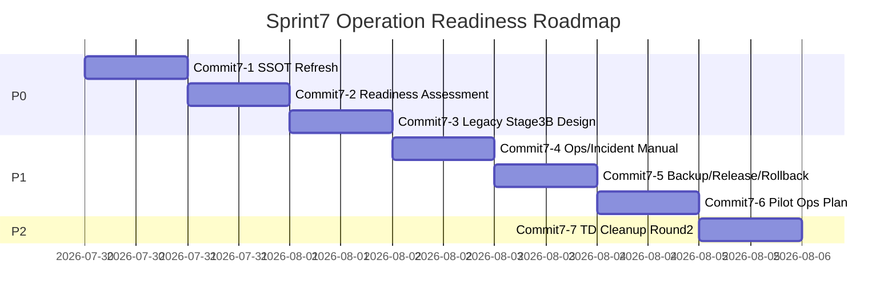

# Sprint 7 — Design Freeze v1.0 ("Operation Readiness Sprint")

> **상태**: 설계 문서(Design Freeze). 코드 변경 없음, 신규 기능 없음, Push/Deploy 없음.
> **기준선(Baseline)**: `4f21d0e` — `docs: finalize sprint6 closeout` (Sprint6 Closeout, PM 확정)
> **작성일**: 2026-07-29
> **정의**: Sprint7은 신규 기능 개발이 아니라 **실제 천안의료원 운영환경 적용 가능 수준의 운영 준비 완료**를 성공 기준으로 삼는다.

---

## 목차

1. [Sprint 목표](#1-sprint-목표)
2. [범위](#2-범위)
3. [제외 범위](#3-제외-범위)
4. [사전 조사 — 이번 Design Freeze에서 실제 코드/문서로 확인한 사실](#4-사전-조사)
5. [위험요인](#5-위험요인)
6. [성공기준](#6-성공기준)
7. [산출물](#7-산출물)
8. [Commit 계획](#8-commit-계획)
9. [Sprint7 Roadmap](#9-sprint7-roadmap)
10. [Operation Readiness Checklist(초안)](#10-operation-readiness-checklist초안)

---

## 1. Sprint 목표

Sprint4(Reservation Core)~Sprint6(Legacy Guard/TD Cleanup)에서 쌓인 기능을, 실제 병원 운영 인력이 안전하게 쓸 수 있는 상태로 만든다. 새 화면·새 API·새 Business Rule을 만들지 않고, **운영 문서·절차·복구 대비·품질 검증**을 갖춘다.

## 2. 범위

- P0 Operation Readiness: 운영 준비도 평가, 운영 절차 검증, Legacy Stage3 Phase B **설계**(구현 아님), 운영 체크리스트
- P1 운영 문서: 관리자 운영 매뉴얼, 장애 대응 매뉴얼, Backup/Restore, Release Checklist, Rollback Guide
- P1 Pilot 준비: Pilot 운영계획, KPI, 운영 절차, 사용자 피드백 체계
- P2 Technical Debt: TD-S5-03, TD-S5-05

## 3. 제외 범위

Reservation Portal FastAPI 전환 · 대규모 Backend Refactoring · Google Sheets 구조 변경 · Apps Script 구조 변경 · 신규 Business Rule 추가 · Legacy Stage3 Phase B의 **실제 구현**(설계까지만) — 이번 Sprint 어디에도 포함하지 않는다.

---

## 4. 사전 조사

이번 Design Freeze 작성을 위해 실제 문서·코드를 확인했다(추측 없음).

### 4-1. SSOT 문서 드리프트(신규 발견, P0 최우선 근거)

- **`PROJECT_STATUS.md`**: "현재 최우선 작업 순서... 다음: Sprint 4 Commit 2(예약 승인) PM 승인 대기"로 기술되어 있다. **실제로는 Sprint4 Commit2~5-2, Sprint5(Commit5-3.1~5-3.3), Sprint6(Commit6-1~6-3)까지 전부 완료된 상태**다 — 최소 3개 Sprint 분량의 진행 상황이 반영되지 않았다.
- **`ROADMAP.md`**: "Sprint 5 — Patient Portal Integration(예정)", "Sprint 6 — Pilot Ready(예정)"로 적혀 있으나 실제 Sprint5는 "Portal Integration"(Admin Portal Error Contract), Sprint6은 "Legacy Guard + Technical Debt Cleanup"이었다 — Sprint 이름·내용 모두 실제와 다르다.
- **`CLAUDE.md`**(프로젝트 지침): "최우선 작업 순서: ① STEP1.5 DateFix 배포+재QA → ② 전체 QA → ③ v0.9.0 Pilot Release"로 기술되어 있으나 이 3단계는 2026-07-12에 이미 완료됐고(PROJECT_STATUS.md §2 자체 기록) 그 이후 Sprint3~6이 전부 지나갔다.

**결론**: 프로젝트의 SSOT 문서 자체가 실제 상태를 반영하지 못하고 있다. 이 상태로는 "운영 준비도 평가"가 무엇을 기준으로 해야 하는지조차 신뢰할 수 없다 — **SSOT 갱신이 Sprint7의 다른 모든 작업의 선행조건**이다.

### 4-2. 이미 존재하는 운영 자산(재발명 방지, P1 근거)

- `src/deploy/backup_policy.md`(36줄, "Sprint H" 시절 작성) — `data/` 로컬 JSON 백업 정책은 이미 있으나, **Sprint4 ADR-013(예약 SSOT=Google Sheets) 이후 작성된 것이 아니라서 Sheets 백업/버전 관리는 다루지 않는다.**
- `tests/run_backup_restore_rehearsal.py`(95줄) + `tests/backup_restore_rehearsal_result.csv` — 백업/복구 리허설 테스트가 이미 존재. Sprint7에서는 이를 **재실행해 여전히 유효한지 확인**하고, Sheets 관련 내용을 보강하는 방향이 맞다(신규 작성 아님).
- `PROJECT_STATUS.md` §2-1에 "Release Checklist 결과(v1.0.0-pilot 기준)" 표가 이미 인라인으로 존재 — Sprint7의 "Release Checklist" 산출물은 이를 **독립 문서로 승격·현행화**하는 작업이지 백지에서 새로 쓰는 것이 아니다.
- Rollback Guide에 해당하는 독립 문서는 확인되지 않음 — 이 항목만 실질적으로 신규 작성.

### 4-3. Legacy Stage3 Phase B 관련(Sprint5/6에서 이미 확정된 사실 재확인)

Sprint6 Design Freeze §1-1에서 확인한 대로, `reservation_approval_states.py`는 검진완료/일정변경/예약취소 전이를 Legacy Portal이 전담하도록 **원래부터 설계**되어 있다. Commit6-1은 "예약확정" 전이만 막았다(TD-S5-04 Partial). Phase B(완전 해소)는 Admin Portal에 이 3개 전이 기능을 신설해야 하며, 이는 새 FastAPI 엔드포인트가 필요한 **Backend 구조 변경**이다 — Sprint7 원칙 9("Backend/FastAPI 구조 변경 금지, 별도 승인 전")에 따라 Sprint7은 **설계까지만** 하고 승인 없이 구현하지 않는다.

---

## 5. 위험요인

| 등급 | 내용 | 대응 |
|---|---|---|
| **High** | SSOT 문서(PROJECT_STATUS/ROADMAP/CLAUDE.md) 드리프트로 인해 향후 어떤 작업자(사람이든 AI든)도 "현재 상태"를 잘못 파악할 위험 | Commit7-1을 최우선으로 배치, 실제 커밋 이력(git log) 기준으로 재작성 |
| High | Legacy Stage3 Phase B 없이는 검진완료/일정변경/예약취소가 여전히 Slot/Policy 검증 없는 경로로 남음(TD-S5-04 잔여 위험) | 이번 Sprint는 설계만 — Phase B 구현은 Backend 변경 승인이 필요한 별도 작업으로 명확히 분리해 리스크를 축소하지 않고 정직하게 이월 |
| Medium | Sheets를 SSOT로 하는 백업 정책이 없어, GAS/Sheets 장애 시 복구 절차가 명확하지 않음 | Commit7-6에서 기존 백업 정책을 Sheets 관점으로 보강(신규 인프라 구축은 범위 밖, 문서화 우선) |
| Medium | 운영 매뉴얼 부재로 실제 배포 시 담당자 교육 공백 발생 가능 | Commit7-4에서 Admin Portal 실사용 흐름 기준으로 작성 |
| Low | TD-S5-03/05는 낮은 영향도이나 Sprint7까지 미해결로 누적 | Commit7-7에서 정리 |

## 6. 성공기준(Definition of Done, Sprint 단위)

- [ ] PROJECT_STATUS.md/ROADMAP.md/CLAUDE.md가 `4f21d0e` 기준 실제 상태와 일치
- [ ] Operation Readiness Checklist 전 항목에 대해 실측 근거(코드/문서/테스트) 있는 답변 확보
- [ ] Legacy Stage3 Phase B Implementation Plan 문서 존재(구현은 아직 없음)
- [ ] 관리자 운영 매뉴얼·장애 대응 매뉴얼 작성 완료, 실제 화면/API와 대조 검증
- [ ] Backup/Restore 리허설 재실행 PASS, Release Checklist·Rollback Guide 독립 문서화
- [ ] Pilot 운영계획에 KPI·절차·피드백 체계 포함
- [ ] TD-S5-03/05 해소
- [ ] 전 Commit PM 검토 완료, Push/Deploy 없음

## 7. 산출물

`Sprint7_Design_Freeze_v1.0.md`(이 문서), 이후 Commit별 산출물은 §8 표 참조.

---

## 8. Commit 계획

| Commit | 제목 | 우선순위 | 내용 | 주요 산출물 |
|---|---|---|---|---|
| **Commit7-1** | SSOT Documentation Refresh | P0 | `PROJECT_STATUS.md`/`ROADMAP.md`/`CLAUDE.md`를 `4f21d0e` 기준 실제 상태로 현행화(git log 기준, 추측 없음) | 갱신된 SSOT 문서 3종 |
| **Commit7-2** | Operation Readiness Assessment & Checklist | P0 | §10 초안을 실제 검증해 확정, 운영 준비도 평가 보고서 작성 | Assessment 문서, Checklist v1.0 |
| **Commit7-3** | Legacy Stage3 Phase B Design | P0 | 검진완료/일정변경/예약취소를 Admin Portal로 흡수하는 방안 설계(구현 안 함) | Implementation Plan(설계 문서) |
| **Commit7-4** | Admin Operations Manual + Incident Response Manual | P1 | 관리자 운영 매뉴얼(Admin Portal 실사용 흐름), 장애 대응 매뉴얼(GAS/Sheets/FastAPI 장애 시나리오별 대응) | 매뉴얼 2종 |
| **Commit7-5** | Backup/Restore · Release Checklist · Rollback Guide | P1 | 기존 `backup_policy.md`/리허설 테스트 재검증·Sheets 관점 보강, `PROJECT_STATUS.md` 인라인 체크리스트를 독립 Release Checklist로 승격, 신규 Rollback Guide 작성 | 문서 3종 + 리허설 재실행 결과 |
| **Commit7-6** | Pilot Operations Plan | P1 | Pilot 운영계획, KPI 정의, 운영 절차, 사용자 피드백 체계 | Pilot 운영계획 문서 |
| **Commit7-7** | Technical Debt Cleanup Round 2 | P2 | TD-S5-03(`nav_new.js` 링크 정리), TD-S5-05(관련 테스트 재실행으로 스냅숏 갱신) | 코드 소폭 수정 + 테스트 결과 |

각 Commit은 이전 Commit의 PM 승인을 전제로 순차 진행하며, 이번 Design Freeze에서는 어느 것도 착수하지 않는다.

---

## 9. Sprint7 Roadmap

(일정은 순서를 나타내기 위한 상대 표시이며, 실제 착수 시점은 각 Commit의 PM 승인에 따른다.)

---

## 10. Operation Readiness Checklist(초안)

이 초안은 Commit7-2에서 실제 검증을 거쳐 확정한다. 아래는 이번 Design Freeze 시점의 초안 항목이다.

### 10-1. Backend/FastAPI
- [ ] `2ac84d9`(Sprint3 마감)부터 `4f21d0e`(Sprint6 마감)까지 전 회귀 스위트 재실행·PASS 확인
- [ ] 환경변수(`CSHSP_GAS_WEBAPP_URL` 등) 운영 서버 설정 절차 문서화 여부
- [ ] RBAC 역할·권한 매핑(`roles.json`/`users.json`)이 실제 운영 인력 구성과 맞는지 확인

### 10-2. Portal(Admin/Reservation/Legacy)
- [ ] Admin Portal 승인/거절/대시보드/통계/상담관리/감사로그 6개 탭 실사용 시나리오 문서화
- [ ] Legacy Portal의 "예약확정 차단" 가드(Commit6-1)가 실제 배포 환경에서도 동일하게 동작하는지 재확인
- [ ] Reservation Portal(수검자 폼)의 실제 운영 GAS URL 설정 상태 확인

### 10-3. Google Sheets / Apps Script
- [ ] Sheets 백업/버전 이력 정책 존재 여부(Google 자체 버전 기록 vs 별도 백업)
- [ ] GAS 배포 버전 관리(재배포 시 "새 버전" 사용 원칙 — STEP1.5 사고 재발 방지) 문서화

### 10-4. 데이터/보안
- [ ] 더미 데이터/계정 정리 여부(ROADMAP.md에 "여전히 대기"로 기록된 항목 — Sprint7에서 최종 확인)
- [ ] PII 마스킹 정책이 전 API 응답에 일관 적용되는지 재확인

### 10-5. 운영 절차
- [ ] 장애 발생 시 1차 대응자·에스컬레이션 경로 정의 여부
- [ ] 배포 승인·롤백 의사결정권자 정의 여부

---

## 완료 조건 준수 확인

이 문서 작성 중 어떤 코드 파일도 수정하지 않았다(Read/Grep만 수행). Commit/Push/Deploy 없음. Business Rule/Backend/FastAPI 구조 변경 없음.
