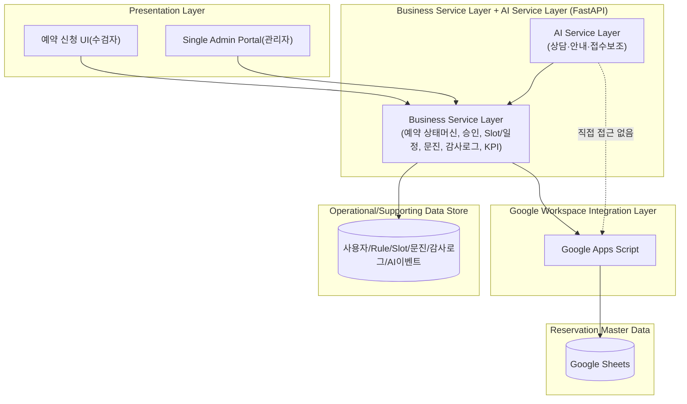
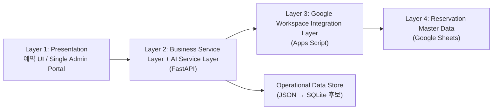
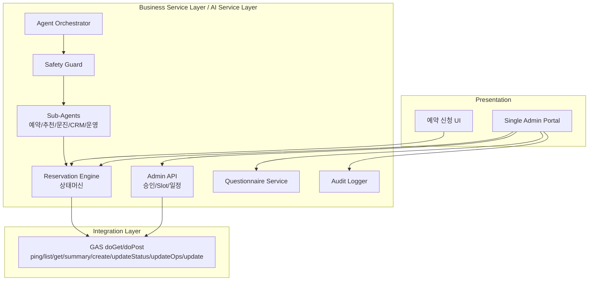
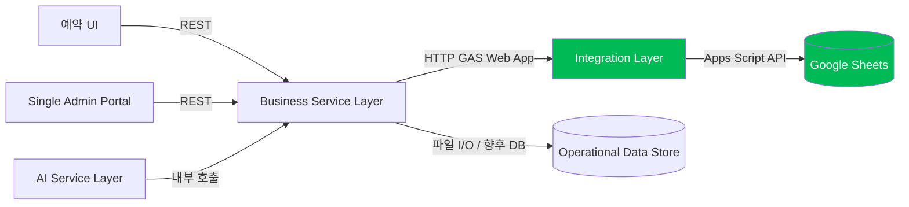
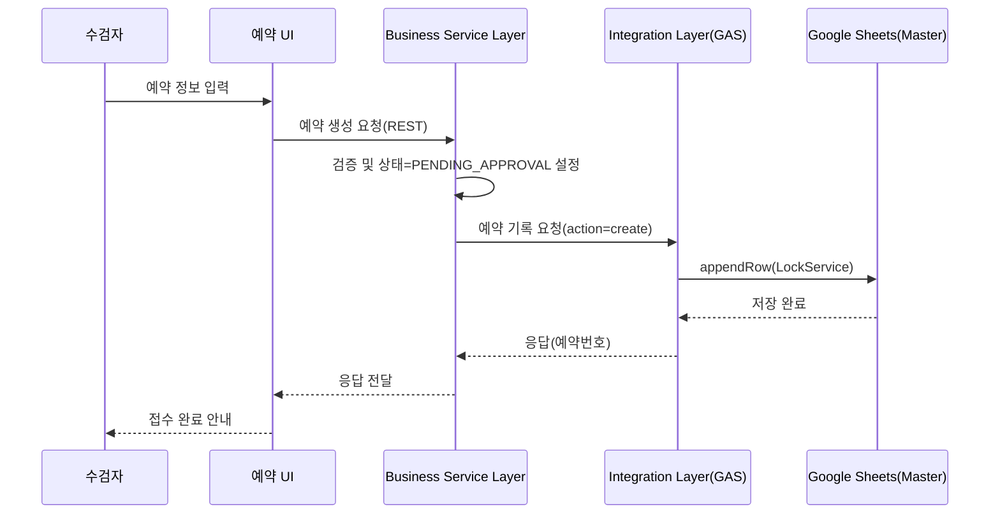
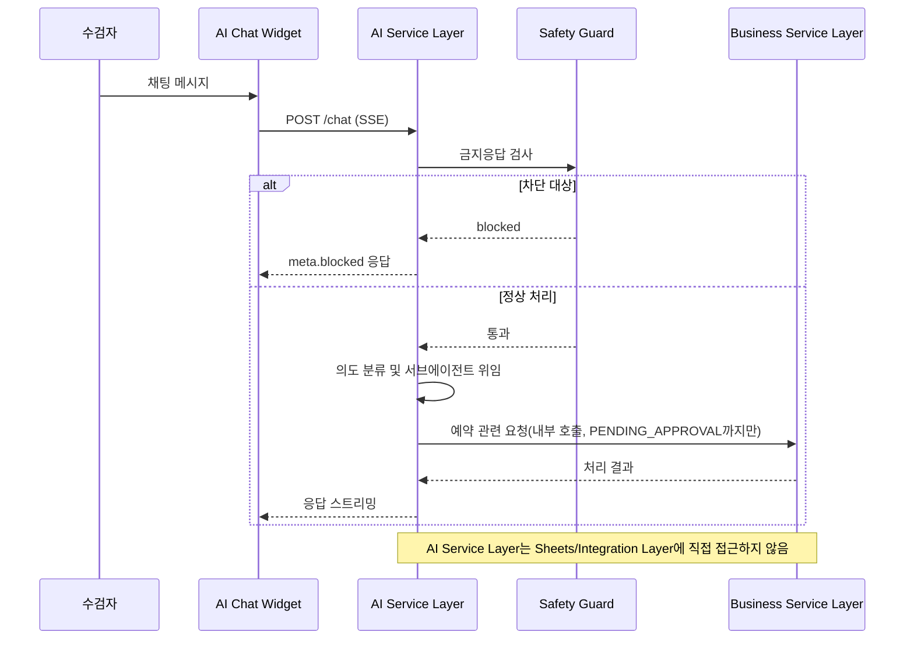
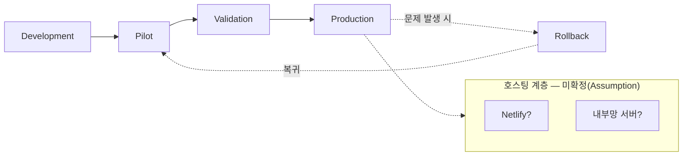

# Enterprise Architecture Specification — To-Be (Target Architecture)

## 문서 정보

| 항목 | 내용 |
|---|---|
| 문서명 | CMC Platform (CSHSP) Enterprise Architecture Specification — To-Be v1.0 |
| 버전 | v1.0 |
| 상태 | Draft — PM 승인 대기 |
| 작성일 | 2026-07-26 |
| Sprint | Sprint 0.5(Enterprise Architecture 설계 단계) — Sprint 0 종료 PM 승인 후 착수 |
| 상위 문서 | [Project_Charter_V1.1_Final_Draft.md](../../../Project_Charter_V1.1_Final_Draft.md) |
| 근거 문서 | [Enterprise_Architecture_AsIs_v1.0.md](../../../Enterprise_Architecture_AsIs_v1.0.md), [Enterprise_Architecture_Review_Gap_v1.0.md](../../../Enterprise_Architecture_Review_Gap_v1.0.md), [Architecture_Decision_Record_v1.0.md](../../../Architecture_Decision_Record_v1.0.md)(ADR), [Sprint0_Closure_Report_v1.0.md](../../../Sprint0_Closure_Report_v1.0.md), Repository Assessment(5종), Platform Architecture Discovery(6종) |

> **ADRB(Architecture Decision Review Board) 승인사항에 대한 출처 표기**: 이번 To-Be 설계는 PM이 이번 지시에서 직접 전달한 5개 확정 결정(§0)을 고정 입력으로 사용한다. Repository 전체를 재확인한 결과 저장소 내에는 "ADRB"라는 이름의 문서가 존재하지 않는다 — 이는 정상이며, 아래 §0 결정사항은 **본 세션에서 PM이 직접 승인·전달한 내용**을 근거로 한다. 이 문서는 그 사실을 그대로 기록하며, 마치 기존 저장소 문서에서 발견한 것처럼 서술하지 않는다.

---

## 0. ADRB 확정 결정사항 (변경하지 않음, 본 문서의 고정 전제)

| 구성요소 | 확정 역할 |
|---|---|
| Google Sheets | **Reservation Master Data** — 예약 데이터의 기준원장(Single Source of Truth) |
| Google Apps Script | **Google Workspace Integration Layer** — Sheets 연동 게이트웨이 |
| FastAPI | **Business Service Layer + AI Service Layer** — 비즈니스 로직 및 AI 상담 처리 계층(예약 마스터 데이터를 자체 보유하지 않음) |
| Target(관리자) | **Single Admin Portal** — 관리자 화면을 단일 포털로 통합 |
| Deployment | **Development → Pilot → Validation → Production → Rollback** 5단계 파이프라인 |

이 5개 결정은 ADR-001(기준원장), ADR-002(Sheets 역할), ADR-003(GAS 역할), ADR-004(FastAPI 역할), ADR-005/006(관리자 통합), ADR-010(배포 원칙 중 파이프라인 단계)을 **확정**한다. 단, ADR-010 중 "호스팅 계층(Netlify vs 내부망 서버)이 무엇인가"는 이번 ADRB 결정에 포함되지 않았으므로 **여전히 미확정**이며, 본 문서는 이를 가정(Assumption)으로 명시하고 확정되는 대로 갱신되어야 한다(§7, §9).

---

## 1. Executive Summary

CMC Platform(CSHSP)의 Target Architecture는 As-Is 상태에서 확인된 핵심 문제(이중 예약 저장소, 관리자 기능 3화면 분산, 백엔드 간 미연계)를 ADRB 결정에 따라 해소하는 **4계층 아키텍처**로 정의된다: (1) Presentation Layer(수검자 예약 UI + Single Admin Portal), (2) Business Service Layer + AI Service Layer(FastAPI), (3) Google Workspace Integration Layer(Apps Script), (4) Reservation Master Data(Google Sheets). 현재 FastAPI가 로컬 JSON을 예약 원장으로 직접 사용하던 구조는, Target 상태에서 **Business Service Layer가 Integration Layer를 경유해 Sheets를 예약 데이터의 유일한 기준으로 읽고 쓰는 구조**로 전환된다. 관리자 기능은 현재의 3개 화면(Sheets 직접연동/Mock 콘솔/대시보드)에서 **Single Admin Portal 하나**로 통합되며, 모든 관리자·수검자·AI 요청은 Business Service Layer를 거쳐서만 Sheets에 접근한다 — 이는 현재 클라이언트 코드에 직접 하드코딩된 연동 정보를 서버 계층으로 이동시켜 보안 측면도 함께 개선한다(ADR-014와 정합). 호스팅 계층(Netlify/내부망) 확정과 데이터베이스 확장(SQLite 등)은 이 문서의 범위에서 가정으로 남겨두며, 확정 즉시 문서를 갱신한다.

---

## 2. Business Architecture

### 2-1. 이해관계자(Stakeholders)
- 병원장 및 의료정보위원회 — 최종 승인권자
- 검진센터 직원(관리자) — Single Admin Portal 사용자
- 전산·운영 담당자 — 배포·운영·장애대응
- 수검자 — 예약 신청·AI 상담 이용자
- AI Service Layer — 상담·안내·접수 보조(의료적 판단 및 예약 확정 권한 없음, Charter §4·ADR-008 재확인)

### 2-2. 핵심 비즈니스 프로세스
```
수검자 예약 신청 → (Business Service Layer 경유) → Sheets 기록(PENDING)
  → 관리자 승인(Single Admin Portal) → 상태 전이(CONFIRMED/REJECTED)
  → 검진 진행 → 완료(COMPLETED) / 취소(CANCELLED) / 노쇼(NO_SHOW)
```
모든 상태 전이는 감사로그로 기록된다(Business Service Layer 책임, ADR-013 운영환경 우선 원칙과 정합).

### 2-3. 가치 흐름(Value Chain)
접수(수검자 UI) → 검증·승인(Business Service Layer + 관리자) → 원장 반영(Integration Layer → Sheets) → 운영 가시화(KPI/대시보드) → 사후 분석(AI 상담 통계, 감사로그)

---

## 3. Business Capability Map

| Capability | 정의 | 담당 계층 |
|---|---|---|
| 예약 접수 관리 | 수검자 예약 신청 접수, 검증 | Presentation(예약 UI) + Business Service Layer |
| 예약 승인 관리 | 승인/거절/취소/변경/완료 상태 전이 | Business Service Layer, Single Admin Portal |
| 검진 프로그램 관리 | 프로그램·선택검사 Rule 관리 | Business Service Layer(Rule 엔진), Presentation |
| 검사실·일정 관리 | Slot 생성, 일정 조회 | Business Service Layer |
| AI 상담 지원 | 안내, 예약 접수 보조, 문의 응대 | AI Service Layer |
| 문진 관리 | 문진 시작·제출·검토 | Business Service Layer, Single Admin Portal |
| 운영 통계/KPI | 대시보드, 검사실 현황 | Business Service Layer, Single Admin Portal |
| 감사·컴플라이언스 | 상태 전이 이력, 개인정보 마스킹 | Business Service Layer |
| 알림 관리 | 예약 관련 알림(현재 Mock) | Business Service Layer |
| 인증·보안 관리(Future Scope) | 관리자/수검자 인증 | Business Service Layer, Single Admin Portal(향후 도입) |

---

## 4. Application Architecture

| 애플리케이션 | 역할(ADRB 확정) | 대체 대상(As-Is) |
|---|---|---|
| **예약 신청 UI** | 수검자 예약 접수 화면. Business Service Layer를 통해서만 예약을 등록한다. | `reservation_v3_new.html`의 후속(직접 GAS 호출 방식은 Target에서 Business Service Layer 경유로 전환) |
| **Single Admin Portal** | 승인/조회/Slot/일정/감사로그/문진검토/AI통계를 하나의 포털에서 제공 | `admin_reservations_v2_new.html` + `admin/index.html` + `admin_dashboard_v3_new.html` 3화면 통합 |
| **Business Service Layer(FastAPI)** | 예약 상태머신, 권한검증(RBAC), Slot/일정, 문진, 감사로그, KPI 집계. Sheets를 자체 캐시 없이 Integration Layer 경유로 읽고 쓴다. | 현행 FastAPI(`api_server.py`)의 역할을 재정의 — 로컬 JSON을 예약 마스터로 쓰던 부분을 Sheets 경유로 전환 |
| **AI Service Layer(FastAPI 내)** | 상담·안내·예약 접수 보조. 예약 관련 작업은 반드시 Business Service Layer API를 호출하며 Sheets/GAS를 직접 호출하지 않는다. | 현행 `routes_agents.py`, `agent_orchestrator` 구조 유지, 호출 경로만 Business Service Layer로 일원화 |
| **Google Workspace Integration Layer(Apps Script)** | Sheets에 대한 유일한 쓰기·읽기 게이트웨이. 호출 주체는 Business Service Layer로 한정한다(직접 브라우저 호출 폐지). | 현행 `sheets_api_v3_final.gs`의 7개 액션 유지, 호출자만 변경 |
| **Reservation Master Data(Google Sheets)** | 예약 레코드의 유일한 기준원장 | 현행 `종합검진_예약대장` 유지 |
| **Operational/Supporting Data Store** | 예약 마스터가 아닌 지원 데이터(사용자/역할, 프로그램/Rule, 문진, 감사로그, AI 이벤트, 세션)를 보관 — Business Service Layer 전속 소유 | 현행 로컬 `data/*.json`(Core Data Layer)의 역할 축소·재정의 |

---

## 5. Data Architecture

### 5-1. 데이터 소유권 원칙 (ADRB 결정의 직접 귀결)

| 데이터 | 소유(기준원장) | 접근 경로 |
|---|---|---|
| 예약 레코드(reservations) | **Google Sheets** | Business Service Layer → Integration Layer(GAS) → Sheets. 다른 어떤 계층도 Sheets를 직접 호출하지 않는다. |
| 사용자/역할(users, roles) | Operational Data Store(Business Service Layer 소유) | Business Service Layer 내부 |
| 프로그램/선택검사 Rule(programs, optional_tests, checkup_rules) | Operational Data Store | Business Service Layer 내부, Presentation에 참조 제공 |
| Slot/일정(slots, schedules) | Operational Data Store | Business Service Layer 내부 |
| 문진(questionnaires, consents) | Operational Data Store | Business Service Layer 내부 |
| 감사로그(audit_logs) | Operational Data Store(append-only) | Business Service Layer 전속 기록 |
| AI 이벤트/세션(ai_events, sessions) | Operational Data Store | AI Service Layer가 Business Service Layer를 통해 기록 |

### 5-2. 데이터 일관성 원칙
예약 레코드는 Sheets 단일 기준원장이므로 As-Is의 "이중 저장소 미동기화" 문제(Gap Analysis §5 Data)가 구조적으로 해소된다. Operational Data Store는 예약 레코드의 사본을 보관하지 않으며, 필요 시 조회 시점에 Integration Layer를 통해 Sheets를 조회한다(캐시 전략은 NFR §11에서 원칙만 다루며 구현 방법은 본 문서 범위 밖).

### 5-3. 확장성 경로
Operational Data Store는 현재 로컬 JSON 파일 기반이며, `docs/SQLite_Migration_Plan.md`에 정의된 트리거 조건(다중 프로세스 확장/1만 건 초과/동시 쓰기 충돌/통계 복잡화)이 충족되면 SQLite 등으로 이관을 검토한다(ADR-015 재확인, 이관 자체는 본 문서 범위 밖).

---

## 6. AI Architecture

```
수검자 ── 채팅 ──▶ AI Service Layer(agent_orchestrator)
                        │
                 1) Safety Guard(금지응답 차단)
                        │
                 2) 의도 분류(규칙 기반 기본 / Claude API 옵트인)
                        │
                 3) 서브에이전트 위임(예약/추천/문진/CRM/운영)
                        │
                        ▼
              Business Service Layer API 호출(HTTP, 내부)
              (AI Service Layer는 Sheets/GAS를 직접 호출하지 않음)
                        │
                        ▼
              예약 생성 시 상태 = PENDING_APPROVAL까지만
              (예약 확정은 관리자만 가능 — Single Admin Portal 경유)
```

**불변 원칙(변경하지 않음)**: AI Service Layer는 예약을 직접 확정(CONFIRMED)할 수 없다. 이는 Safety Guard, Allowed Tool 화이트리스트, Business Service Layer의 권한 검증(RBAC) 3중 방어로 유지된다(Charter §4, §8, ADR-008 재확인). Target Architecture에서 AI Service Layer의 호출 경로가 Business Service Layer로 일원화됨에 따라, AI가 Integration Layer나 Sheets에 접근할 수 있는 경로 자체가 아키텍처적으로 존재하지 않게 된다 — 이는 As-Is 대비 안전장치가 한 단계 더 구조적으로 강화되는 지점이다.

---

## 7. Technology Architecture

| 계층 | 기술(As-Is 유지) | Target 변경사항 |
|---|---|---|
| Presentation | HTML5/CSS3/Vanilla JS | Single Admin Portal로 관리자 화면 통합(프레임워크 채택 여부는 미결정 — ADR-007 "현행 유지, 프레임워크 도입은 To-Be 논의로 이관"과 일치, 본 문서에서 신규로 결정하지 않음) |
| Business/AI Service Layer | Python, FastAPI, uvicorn | 예약 관련 엔드포인트가 Sheets를 최종 소스로 조회·기록하도록 역할 재정의(내부 로직 변경, 외부 인터페이스는 유지 가능) |
| Integration Layer | Google Apps Script | 호출 주체를 Business Service Layer로 한정(현재는 브라우저가 직접 호출) |
| Master Data | Google Sheets | 역할 공식화(As-Is에서 암묵적으로 쓰이던 것을 ADRB로 명문화) |
| Operational Data | JSON 파일 | 역할 축소(예약 마스터 제외), 향후 SQLite 이관 후보(§5-3) |
| 호스팅(Presentation) | **미확정 — Assumption** | Netlify 또는 내부망 서버 중 확정 필요(ADR-010, 이번 ADRB 결정 범위 밖) |
| VCS | git + GitHub | 변경 없음(ADR-011 별도 검토 대상) |

---

## 8. Security Architecture (High Level)

원칙 수준만 정의하며, 구체적 구현은 별도 Security Policy 문서(Sprint0_Closure_Report §7에서 To-Be 문서로 제안됨)로 이관한다.

1. **연동 정보 중앙화**: Sheets 연동 정보(Apps Script URL 등)는 Business Service Layer(서버 측)에서만 보관하며, Presentation Layer(브라우저) 코드에는 포함하지 않는다 — As-Is의 클라이언트 코드 하드코딩 문제(ADR-014)를 아키텍처 구조로 해소한다.
2. **AI 접근 통제**: AI Service Layer는 Sheets/Integration Layer에 대한 직접 접근 경로를 갖지 않는다(§6).
3. **인증(Future Scope)**: Single Admin Portal 및 Business Service Layer에 실인증 도입이 필요하다(Charter §6-3, Go-Live 필수 요건). 본 문서는 이 필요성만 명시하며 인증 방식은 설계하지 않는다.
4. **개인정보 취급**: 기존 원칙(마스킹, 대화 원문 미저장, 개인정보 미커밋)을 Target Architecture에서도 그대로 유지한다(Charter §9 Constraints).

---

## 9. Deployment Architecture

ADRB가 확정한 파이프라인 5단계를 원칙 수준으로 정의한다(구현 절차는 범위 밖).

| 단계 | 목적 |
|---|---|
| **Development** | 기능 개발 및 로컬 검증 |
| **Pilot** | 제한된 범위·기간의 실사용 검증(현재 진행 중인 파일럿 운영과 동일한 성격) |
| **Validation** | Pilot 결과에 대한 품질 게이트 검증(회귀 테스트, Go-Live 기준 대조) |
| **Production** | 정식 운영 전환 |
| **Rollback** | 문제 발생 시 이전 안정 버전으로 즉시 복귀 — 상시 대기 상태로 유지되는 능력이며 일회성 단계가 아님 |

**미확정 사항(Assumption)**: 이 파이프라인이 실행되는 물리적 호스팅 위치(Netlify/내부망 서버)는 확정되지 않았다(§0, §7). 본 문서는 파이프라인의 논리적 단계만 정의하며, 호스팅 확정 후 물리적 배포 절차를 별도 Deployment Guide에서 구체화해야 한다.

---

## 10. Integration Architecture

| 인터페이스 | 방향 | 프로토콜 | 비고 |
|---|---|---|---|
| Presentation(예약 UI, Single Admin Portal) → Business Service Layer | 요청/응답 | HTTP REST / SSE(AI 채팅) | 모든 사용자 요청의 단일 진입점 |
| Business Service Layer → Google Workspace Integration Layer(GAS) | 요청/응답 | HTTP(GAS Web App) | 예약 마스터 데이터 접근 전용 경로 |
| Google Workspace Integration Layer → Google Sheets | 내부 | Apps Script 내장 API | 변경 없음 |
| AI Service Layer → Business Service Layer | 내부 함수/모듈 호출 또는 내부 API | 동일 프로세스 내(FastAPI 내부) 또는 내부 HTTP | AI는 이 경로 외 다른 접근 경로를 갖지 않음 |
| Business Service Layer ↔ Operational Data Store | 내부 | 파일 I/O(현행) → DB(SQLite, 트리거 도달 시) | §5-3 |

**As-Is 대비 핵심 변화**: As-Is에서는 Presentation Layer(브라우저)가 Integration Layer(GAS)를 직접 호출했다(DATA_FLOW_ANALYSIS.md §2). Target에서는 이 직접 호출 경로가 폐지되고, **모든 Sheets 접근이 Business Service Layer를 경유**한다. 이는 Gap Analysis에서 지적된 "GAS ↔ FastAPI 연계 없음" 문제를 구조적으로 해소하는 핵심 변경이다.

---

## 11. Non-Functional Requirements (NFR)

정량 목표는 실측 이력이 있는 경우에만 인용하며, 근거 없는 수치는 제시하지 않는다.

| 항목 | 원칙 |
|---|---|
| **가용성** | Rollback 능력(§9)을 상시 유지해 장애 시 신속히 이전 상태로 복귀할 수 있어야 한다. |
| **데이터 일관성** | 예약 레코드는 Sheets 단일 기준원장 원칙(§5-1)을 따르며, 복수 저장소 간 불일치가 발생하지 않아야 한다. |
| **성능** | 참고: DEV-003 QA에서 측정된 기존 Live 모드 응답시간(1.765초, `RELEASE_REPORT_v1.0.0-pilot_new.md` 근거)이 실측 기준점으로 존재한다. Target Architecture에서 Business Service Layer 경유가 추가되므로, 이 기준점 대비 응답시간 변화를 Validation 단계(§9)에서 반드시 재측정해야 한다. |
| **확장성** | `docs/SQLite_Migration_Plan.md`의 트리거 조건을 Operational Data Store 확장 판단 기준으로 유지한다(ADR-015). |
| **유지보수성** | 계층 간 책임이 명확히 분리되어(§4) 특정 계층 변경이 다른 계층에 미치는 영향이 최소화되어야 한다. |
| **보안** | §8 원칙을 따른다. |
| **감사 가능성** | 모든 예약 상태 전이는 Business Service Layer의 감사로그에 append-only로 기록되어야 한다(현행 원칙 유지). |

---

## 12. Architecture Principles

1. **단일 기준원장 원칙** — 예약 레코드의 진실은 Google Sheets 하나이며, 다른 계층은 이를 복제·대체하지 않는다.
2. **계층화 원칙** — Presentation은 Business/AI Service Layer만 호출하고, Integration Layer는 Business Service Layer만 호출하며, Sheets는 Integration Layer를 통해서만 접근된다.
3. **AI 안전 우선 원칙** — AI Service Layer는 예약을 직접 확정하지 않으며, Sheets/Integration Layer에 대한 직접 접근 경로를 갖지 않는다.
4. **보안 중앙화 원칙** — 민감한 연동 정보는 서버 계층에만 보관하고 클라이언트 코드에 포함하지 않는다.
5. **점진적 전환 원칙** — 본 Target Architecture로의 전환은 Charter §3 Vision의 "점진적 확장" 원칙을 따르며, 일괄 전환(Big-Bang)을 지향하지 않는다(Sprint Roadmap §13 참조).
6. **가정의 명시적 관리 원칙** — 호스팅 계층 등 미확정 사항은 가정(Assumption)으로 명시하고, 확정되는 즉시 문서를 갱신한다.

---

## 13. Sprint Roadmap (목표 수준, 구현 계획 아님)

Sprint 0(Enterprise Architecture 사전조사) → Sprint 0.5(본 문서, Target Architecture 확정) 이후의 논리적 다음 단계를 목표 수준으로만 제시한다. 일정·공수는 포함하지 않는다.

| Sprint | 목표 |
|---|---|
| Sprint 1 | Business Service Layer가 Integration Layer(GAS)를 경유해 Sheets를 예약 마스터로 읽고 쓰도록 연동 경로를 확립한다. |
| Sprint 2 | Single Admin Portal로 관리자 화면(3개)을 통합한다. |
| Sprint 3 | 연동 정보를 서버 계층으로 중앙화하고, 관리자 실인증을 도입한다(§8). |
| Sprint 4 | Deployment Pipeline(§9)의 각 단계(특히 Validation)에 필요한 검증 절차를 확립한다. |
| Sprint 5 | AI Service Layer의 호출 경로를 Business Service Layer로 일원화하고(§6), NFR(§11) 재측정을 수행한다. |

각 Sprint의 상세 작업 항목, 순서 조정, 병행 가능 여부는 Sprint 착수 시점에 별도로 계획한다(본 문서 범위 밖).

---

## 14. Appendix

### 14-1. 근거 문서
- Project Charter: [Project_Charter_V1.1_Final_Draft.md](../../../Project_Charter_V1.1_Final_Draft.md)
- Repository Assessment: [REPOSITORY_ASSESSMENT_REPORT.md](../../../REPOSITORY_ASSESSMENT_REPORT.md) 외 4종
- Platform Architecture Discovery: [ARCHITECTURE_DISCOVERY_REPORT.md](../../../ARCHITECTURE_DISCOVERY_REPORT.md) 외 5종
- Enterprise Architecture As-Is: [Enterprise_Architecture_AsIs_v1.0.md](../../../Enterprise_Architecture_AsIs_v1.0.md)
- Architecture Review & Gap: [Enterprise_Architecture_Review_Gap_v1.0.md](../../../Enterprise_Architecture_Review_Gap_v1.0.md)
- ADR: [Architecture_Decision_Record_v1.0.md](../../../Architecture_Decision_Record_v1.0.md)(15건)
- Sprint 0 종료 보고서: [Sprint0_Closure_Report_v1.0.md](../../../Sprint0_Closure_Report_v1.0.md)
- ADRB 결정사항: 본 세션에서 PM이 직접 전달(§0) — 저장소 내 별도 문서 없음

### 14-2. Mermaid Diagram 목록
1. Overall Architecture
2. Layer Diagram
3. Component Diagram
4. Integration Diagram
5. Data Flow
6. AI Flow
7. Deployment Diagram

(다이어그램 본문은 각 해당 절 §4~§10에 배치)

---

## Mermaid Diagrams

### Diagram 1 — Overall Architecture



### Diagram 2 — Layer Diagram



### Diagram 3 — Component Diagram



### Diagram 4 — Integration Diagram



### Diagram 5 — Data Flow (예약 생성 기준)



### Diagram 6 — AI Flow



### Diagram 7 — Deployment Diagram


